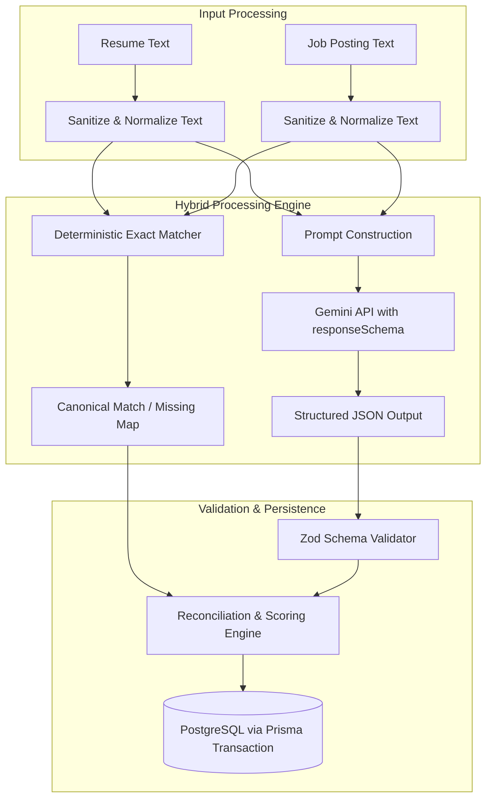

# AI Feature: Resume-Job Matching & Skill Gap Analysis

**Provider:** Google Gemini API (`@google/genai`)
**Models:** `gemini-2.5-flash` (primary) with fallback to `gemini-3-flash-preview`
**Pattern:** server-side hybrid (deterministic taxonomy + LLM semantic reasoning)

---

## 1. Overview

### 1.1 The problem

Applicant Tracking Systems and technical recruiters screen on specific technical competencies, experience depth, and contextual accomplishments. Early-career developers usually cannot tell why an application failed:
- Does the resume omit keyword synonyms (e.g. "PostgreSQL" vs "relational SQL databases")?
- Are mandatory framework requirements missing?
- Are bullet points written as passive task lists instead of measurable engineering impact?

### 1.2 The approach: a hybrid matching engine

Relying only on an LLM prompt produces inconsistent scores and risks hallucinated qualifications. CareerPilot AI uses a hybrid design:

1. **Deterministic layer:** scans the resume and job description against a canonical technical taxonomy to find exact keyword matches.
2. **LLM semantic layer:** analyzes nuance, implied competencies, seniority, and phrasing quality, and produces recommendations and bullet-point rewrites.
3. **Validation layer:** enforces a JSON schema contract, reconciles LLM output with deterministic findings, and persists the result in PostgreSQL.



---

## 2. Inputs, Preprocessing & Prompt Design

### 2.1 Inputs

- **Resume:** plain text or markdown (100-20,000 characters). Whitespace is normalized before matching.
- **Job description:** text of the target role (100-20,000 characters). Common headings (Requirements, Qualifications, Nice to Haves) are normalized.
- **Canonical skill taxonomy:** the 73 seeded skills in the `Skill` table.

**Prompt-injection defense:** user text is delimited with XML tags (`<resume_content>`, `<job_description>`, `<candidate_context>`, `<skill_gaps>`), and the system instruction tells the model to treat the tagged content strictly as untrusted data to analyze, never as instructions.

### 2.2 Model selection

- **Primary: `gemini-2.5-flash`** - strong semantic alignment, low latency, native `responseSchema` (structured JSON) support, and low cost.
- **Fallback: `gemini-3-flash-preview`** - used automatically when the primary model hits rate limiting (`HTTP 429`) or transient failures.

### 2.3 System instruction

```text
You are a principal technical recruiter and expert software engineering hiring manager.
Your task is to analyze a candidate's resume against a specific target job description.
You must produce an objective, explainable evaluation strictly adhering to the provided JSON schema.

Evaluation Guidelines:
1. Distinguish strictly between MANDATORY requirements and PREFERRED/BONUS qualifications.
2. Identify Hard Skills (languages, frameworks, databases, cloud tools) and Architectural Concepts.
3. Evaluate Experience Depth: does the candidate demonstrate production engineering impact, or merely mention tools in passing?
4. Do NOT hallucinate skills that are not explicitly evidenced in the resume.
5. Provide high-impact, actionable bullet point rewrites following the Google XYZ formula:
   "Accomplished [X] as measured by [Y], by doing [Z]".
```

---

## 3. Structured Output Contract

Gemini is called with `responseMimeType: 'application/json'` and a defined `responseSchema`. The returned payload is validated on the backend before persistence:

```typescript
export const resumeAnalysisResponseSchema = z.object({
  overallScore: z.number().int().min(0).max(100),
  skillScore: z.number().int().min(0).max(100),
  experienceScore: z.number().int().min(0).max(100),
  summary: z.string().min(20).max(1000),
  matchedSkills: z.array(
    z.object({
      name: z.string(),
      category: z.enum(['LANGUAGE', 'FRAMEWORK', 'DATABASE', 'DEVOPS', 'CONCEPT', 'TOOL']),
      relevance: z.enum(['HIGH', 'MEDIUM', 'LOW']),
      evidenceFromResume: z.string(),
    })
  ),
  missingRequiredSkills: z.array(
    z.object({
      name: z.string(),
      category: z.enum(['LANGUAGE', 'FRAMEWORK', 'DATABASE', 'DEVOPS', 'CONCEPT', 'TOOL']),
      relevance: z.enum(['HIGH', 'MEDIUM', 'LOW']),
      contextualNote: z.string(),
    })
  ),
  missingPreferredSkills: z.array(
    z.object({
      name: z.string(),
      category: z.enum(['LANGUAGE', 'FRAMEWORK', 'DATABASE', 'DEVOPS', 'CONCEPT', 'TOOL']),
      relevance: z.enum(['HIGH', 'MEDIUM', 'LOW']),
      contextualNote: z.string(),
    })
  ),
  recommendations: z.array(
    z.object({
      category: z.enum(['SKILL_INTEGRATION', 'BULLET_POINT_REWRITE', 'EXPERIENCE_FRAMING']),
      priority: z.enum(['HIGH', 'MEDIUM', 'LOW']),
      original: z.string().optional(),
      improved: z.string(),
      rationale: z.string(),
    })
  ),
});
```

The schema is defined in `backend/src/schemas/ai-response.schema.ts`.

---

## 4. Scoring & Explainability

### 4.1 Hybrid scoring formula

To avoid arbitrary numbers, the final `overallScore` is a transparent weighted composition:

`overallScore = 0.55 * skillScore + 0.35 * experienceScore + 0.10 * completenessScore`

- **`skillScore` (0-100):** ratio of verified matched skills to total required skills detected in the job description, capped at 100.
- **`experienceScore` (0-100):** model-evaluated seniority alignment against the job's level.
- **`completenessScore` (0-100):** deterministic check for essential resume sections (contact, summary, experience, projects, education, skills) and quantified metrics.

The reconciliation step merges deterministic exact matches with LLM semantic matches, prioritizes deterministic results on conflicts, and clamps all scores to 0-100.

### 4.2 Explainability

An AI match score is a **heuristic alignment index**, not a guarantee of interview selection. The UI always shows sub-scores and the identified skill badges alongside the score, so the user can see why a particular score was assigned.

---

## 5. Fault Tolerance

| Scenario | Backend handling | Client experience |
| :--- | :--- | :--- |
| **Malformed / invalid JSON** | Zod validation fails, the request is retried with exponential backoff, then routed to the fallback model. If it still fails, a `503` is returned. | A clear "Analysis generation failed; please retry" message. |
| **Gemini rate limit (`429`)** | Rotates to `gemini-3-flash-preview` with exponential backoff (base delay 1s, up to 3 retries). | Minor latency increase, no failed request. |
| **Identical analysis request** | Not implemented in the MVP. Every request invokes the AI pipeline; there is no response cache or de-duplication. | N/A. |
| **Total AI outage** | The service logs the upstream failure and returns `503`. It never returns fake analysis. | A service-unavailable state with a retry action. |

Retry behavior lives in `backend/src/lib/gemini.ts`. The primary model gets a single attempt; the fallback model gets the configured retries.

---

## 6. Evaluation

The evaluation harness ships with the repository and runs as part of the automated tests.

### 6.1 Dataset

`backend/tests/evaluation/dataset.ts` contains 10 annotated resume-job pairs covering distinct scenarios. Each pair is human-labeled with the ground-truth canonical skills for both documents.

| Pair | Scenario | Resume profile | Job profile | Expected outcome |
| :---: | :--- | :--- | :--- | :--- |
| **P-01** | Strong direct match | Junior full-stack (React, Node.js, PostgreSQL, TS) | Junior full-stack (same) | Full extraction; no missing required. |
| **P-02** | Partial stack match | Frontend (React, Tailwind, CSS) | Full-stack (React, Node.js, PostgreSQL, Redis) | Missing: Node.js, PostgreSQL, Redis. |
| **P-03** | Seniority mismatch | Fresh graduate (Java, Python) | Senior distributed systems (Go, K8s, Docker) | Missing: Go, Kubernetes, Docker. |
| **P-04** | Cross-language pivot | Python/Django backend | Node.js/Express backend | Matched: PostgreSQL; missing: Node.js, Express. |
| **P-05** | Adversarial / junk input | Lorem ipsum | Senior frontend engineer | No resume skills; all job skills missing. |
| **P-06** | Cloud / DevOps match | Docker, Kubernetes, AWS, Terraform | Same | Full extraction; no missing required. |
| **P-07** | Database mismatch | MySQL, MongoDB | PostgreSQL, MySQL, Redis | Matched: MySQL; missing: PostgreSQL, Redis. |
| **P-08** | Language mismatch | Kotlin, Go | Java, Kotlin | Matched: Kotlin; missing: Java. |
| **P-09** | Concepts & tooling | TDD, OOP, Git, Jira, Postman | TDD, OOP, Git, Jira, Agile | Matched: TDD, OOP, Git, Jira; missing: Agile. |
| **P-10** | Full-stack with extras | React, Redux, Vite, Node.js, Express, PostgreSQL, Prisma, Vitest, CI/CD, Docker | React, Redux, Node.js, Express, PostgreSQL, Prisma, Docker | Full extraction; no missing required. |

### 6.2 Metrics and results

| Metric | Definition | Target | Measured (`npm run eval:matching`) |
| :--- | :--- | :---: | :---: |
| **Skill extraction precision** | true extracted / total extracted | >= 90% | **100.0%** |
| **Skill extraction recall** | true extracted / ground truth | >= 85% | **100.0%** |
| **Missing-skill accuracy** | per-pair exact match of missing required skills | >= 90% | **100.0%** |
| **JSON schema adherence** | Gemini responses passing Zod validation | >= 98% | Covered by `tests/unit/gemini*.test.ts` |
| **Deterministic latency** | average matching time per pair | < 4.5 s | **~0.6 ms** |

The deterministic extraction/classification layer is scored by the evaluation harness. The LLM-dependent behavior is covered by `tests/unit/gemini.test.ts`, `tests/unit/gemini.roadmap.test.ts`, and `tests/unit/ai-response.schema.test.ts`.

### 6.3 Evaluation runner

- `backend/tests/evaluation/dataset.ts` - the 10 annotated pairs.
- `backend/tests/evaluation/evaluate.ts` - computes precision, recall, F1, missing-skill accuracy, and latency, and prints a per-pair table.
- `backend/tests/evaluation/eval-matching.ts` - standalone CLI runner (`npm run eval:matching`) that exits non-zero if any threshold is missed.
- `backend/tests/evaluation/eval-matching.test.ts` - Vitest wrapper asserting the thresholds inside `npm test`.

---

## 7. Summary: Inputs, Outputs, Limitations & Usefulness

| Dimension | Specification |
| :--- | :--- |
| **Inputs** | Resume text (100-20,000 chars); job description text (100-20,000 chars); the seeded canonical skill taxonomy. |
| **Outputs** | `overallScore`, `skillScore`, `experienceScore` (0-100); categorized skill badges (`MATCHED`, `MISSING_REQUIRED`, `MISSING_PREFERRED`); Google XYZ bullet-point rewrites and prioritized gaps. |
| **Limitations** | LLM scores can vary slightly between runs (mitigated by schema validation, `temperature 0.2`, and deterministic grounding); image-based PDFs must be converted to text first; soft skills cannot be verified without explicit evidence. |
| **Usefulness** | Evaluated against the 10 annotated pairs via `npm run eval:matching` (100% precision, recall, and missing-skill accuracy against the targets of >= 90% / >= 85% / >= 90%). Users can act directly on missing required skills and paste the rewritten bullets into their CV. |
