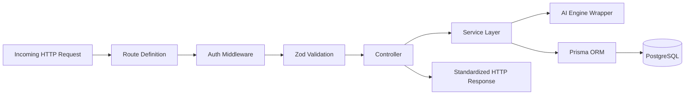

# System Architecture Specification: CareerPilot AI

> **Target Platform:** CareerPilot AI  
> **Document Status:** Approved Engineering Blueprint  
> **Architecture Style:** Decoupled Full-Stack Multi-Tier Architecture  
> **Author:** Senior Software Architect  
> **Version:** 1.0.0  

---

## 1. High-Level Architectural Topology

CareerPilot AI is architected as a decoupled, multi-tier full-stack system comprising a **Next.js frontend application**, a **modular Express.js REST API backend**, a managed **PostgreSQL relational database** accessed via **Prisma ORM**, and an external server-side **Google Gemini AI** engine.

```mermaid
graph TB
    subgraph Client Tier ["Client Tier (Browser)"]
        Browser["Next.js Single Page App / Server Components"]
    end

    subgraph CDN & Edge ["Edge & Hosting (Vercel)"]
        EdgeRouter["Vercel Edge Network / Reverse Proxy"]
    end

    subgraph Backend Tier ["Application Backend (Node.js / Express on Render)"]
        CORS["CORS & Security Headers (Helmet)"]
        AuthMid["Cookie Auth & Session Middleware"]
        ValMid["Zod Input Validation Middleware"]
        Router["Express REST Router (/api/v1)"]
        
        subgraph Controllers ["Controller Layer"]
            ACtrl["Auth Controller"]
            RCtrl["Resume Controller"]
            JCtrl["Job Controller"]
            MCtrl["Match/Analysis Controller"]
            RMCtrl["Roadmap Controller"]
        end

        subgraph Services ["Service & Business Logic Layer"]
            ASvc["Auth Service (Tokens & Hashing)"]
            RSvc["Resume Service"]
            MSvc["Matching & Gap Engine"]
            AISvc["Gemini AI Client Wrapper"]
            RMSvc["Roadmap Service"]
        end

        subgraph DataAccess ["Prisma Data Access Layer"]
            PrismaClient["Prisma ORM Client & Transactions"]
        end
    end

    subgraph Data Tier ["Persistent Data Tier"]
        Postgres[("PostgreSQL Database (Neon / Supabase)")]
    end

    subgraph External Services ["External AI Services"]
        GeminiAPI["Google Gemini Gen AI API"]
    end

    Browser <-->|HTTPS / Secure HttpOnly Cookies| EdgeRouter
    EdgeRouter <-->|REST API Calls (JSON)| CORS
    CORS --> AuthMid --> ValMid --> Router
    Router --> Controllers
    Controllers --> Services
    MSvc --> AISvc
    AISvc <-->|Server-to-Server HTTPS (API Key)| GeminiAPI
    Services --> PrismaClient
    PrismaClient <-->|Connection Pool / TCP| Postgres
```

---

## 2. Frontend/Backend Boundaries & Responsibilities

| Tier / Boundary | Technology | Primary Responsibilities | Strict Anti-Patterns / Forbidden Actions |
| :--- | :--- | :--- | :--- |
| **Frontend Application** | Next.js (App Router), React, TypeScript, Tailwind CSS | - Client-side UI rendering, forms, and interaction state.<br>- Route protection via Next.js middleware and client auth state.<br>- Displaying explainable charts, skill badges, and feedback.<br>- Handling optimistic UI updates for task completions. | - **NEVER** import `@google/genai` or make direct AI API requests from the browser.<br>- **NEVER** store JWTs in `localStorage` or `sessionStorage`.<br>- **NEVER** execute direct database queries. |
| **Backend API Gateway** | Express.js, TypeScript, Node.js | - Terminating CORS and validating request origin.<br>- Parsing and validating all incoming payloads via Zod.<br>- Enforcing authentication via signed httpOnly cookies.<br>- Verifying resource ownership (`userId === record.userId`).<br>- Orchestrating transactions, caching, and rate limiting. | - **NEVER** expose raw database error stack traces to clients.<br>- **NEVER** log raw passwords, authorization tokens, or full resume bodies in cleartext. |
| **Database & ORM Tier** | PostgreSQL, Prisma ORM | - Enforcing relational integrity via foreign keys and constraints.<br>- Managing indexing, transaction rollbacks, and atomic commits.<br>- Storing structured entities (Users, Resumes, Jobs, Analyses, Skills, Roadmaps). | - **NEVER** store unhashed passwords.<br>- **NEVER** leave foreign keys unindexed. |
| **AI Integration Tier** | Google Gen AI SDK (`@google/genai`) | - Receiving sanitized prompts from the matching service.<br>- Enforcing structured JSON responses via SDK schemas.<br>- Providing semantic skill extraction and bullet point improvements. | - **NEVER** accept unvalidated LLM output directly into database persistence without schema verification. |

---

## 3. Modular Backend Architecture

To ensure high maintainability, testability, and adherence to the Single Responsibility Principle without overengineering, the backend adheres to a strictly stratified 4-layer structure:

```
backend/
├── src/
│   ├── config/              # Environment parsing and type-safe configuration
│   ├── middleware/          # Express middlewares (auth, validate, errorHandler, rateLimit)
│   ├── routes/              # Route mapping and middleware chaining (/api/v1/...)
│   ├── controllers/         # HTTP transport layer (parsing requests, status codes)
│   ├── services/            # Pure business logic and AI orchestration
│   ├── schemas/             # Zod validation schemas for requests and AI responses
│   ├── lib/                 # Shared singletons (prisma.ts, gemini.ts, logger.ts)
│   └── types/               # TypeScript type definitions and interfaces
```

### 3.1 Layer Responsibilities & Data Flow



1. **Routes (`routes/*.routes.ts`):** Bind URL paths and HTTP verbs to middlewares and controller functions. Zero business logic.
2. **Middleware (`middleware/*.ts`):** 
   - `authenticate.ts`: Extracts httpOnly session token, verifies validity, and attaches `req.user = { id, email, role }`.
   - `validate.ts`: Generic higher-order middleware accepting a Zod schema; validates `req.body`, `req.query`, or `req.params`. Returns consistent `400 Bad Request` with field-level issues on failure.
   - `errorHandler.ts`: Central Express error-handling middleware intercepting thrown exceptions, mapping domain errors to appropriate HTTP status codes, and redacting internals.
3. **Controllers (`controllers/*.controller.ts`):** Extract validated parameters from `req`, invoke the corresponding service method, and format the response using a standardized envelope:
   ```json
   {
     "success": true,
     "data": { ... },
     "meta": { "timestamp": "2026-10-17T21:00:00.000Z" }
   }
   ```
4. **Services (`services/*.service.ts`):** Contain all core domain logic, calculation algorithms, database transaction coordination, and AI client orchestration. Services are completely decoupled from Express `req` and `res` objects, enabling seamless automated unit testing.

---

## 4. Authentication Architecture & Security Lifecycle

### 4.1 Evaluation of Authentication Strategies

We evaluated three potential authentication architectures for the decoupled Next.js + Express + PostgreSQL stack:

| Strategy | Mechanism | Security Advantages | Architectural Trade-offs | Recommendation |
| :--- | :--- | :--- | :--- | :--- |
| **Strategy 1: Stateless JWT in localStorage** | Token sent via `Authorization: Bearer <token>` | Easy to implement; works across domains without cookie config. | **Severe Vulnerability:** Accessible by any client-side JavaScript; vulnerable to XSS exfiltration. (Used in old repo). | **Rejected** |
| **Strategy 2: Server-Side Stateful Sessions** | Opaque session ID stored in httpOnly cookie; session record looked up in DB on every request. | Instant revocation capability; zero client-side token exposure. | Requires a centralized session store (e.g., Redis or high database write load on session updates). Unnecessary overhead for MVP. | **Rejected for MVP** |
| **Strategy 3: Secure HttpOnly Cookie with JWT + Refresh Token Rotation** | Short-lived signed JWT in httpOnly, SameSite=Lax cookie + refresh token stored in PostgreSQL. | **Immune to JavaScript XSS token theft.** Low DB overhead for requests (JWT verified cryptographically); instant refresh revocation via DB lookup. | Requires proper CORS `credentials: true` and CSRF protection headers. | **Selected & Recommended** |

### 4.2 Authentication Flow Sequence

```mermaid
sequenceDiagram
    autonumber
    actor User as Client (Next.js)
    participant AuthAPI as Express Auth Service
    participant DB as PostgreSQL (Prisma)

    Note over User,AuthAPI: Registration & Login Phase
    User->>AuthAPI: POST /api/v1/auth/login { email, password }
    AuthAPI->>DB: Query user by email
    DB-->>AuthAPI: User record with password hash
    AuthAPI->>AuthAPI: Verify bcrypt password hash
    AuthAPI->>AuthAPI: Generate short-lived Access Token (15m) & Refresh Token (7d)
    AuthAPI->>DB: Save hashed Refresh Token in RefreshToken table
    AuthAPI-->>User: Set-Cookie: access_token=...; HttpOnly; Secure; SameSite=Lax<br>Set-Cookie: refresh_token=...; HttpOnly; Secure; SameSite=Lax<br>HTTP 200 OK { user: { id, name, email } }

    Note over User,AuthAPI: Authenticated Request Phase
    User->>AuthAPI: GET /api/v1/resumes (Cookies automatically sent by browser)
    AuthAPI->>AuthAPI: Verify JWT signature & expiration
    AuthAPI->>DB: Fetch user resumes where userId = req.user.id
    DB-->>AuthAPI: User resumes
    AuthAPI-->>User: HTTP 200 OK { data: resumes }

    Note over User,AuthAPI: Token Refresh Phase (On Access Token Expiry)
    User->>AuthAPI: POST /api/v1/auth/refresh
    AuthAPI->>DB: Validate Refresh Token exists and is not revoked
    AuthAPI->>AuthAPI: Issue new Access Token + Rotate Refresh Token
    AuthAPI->>DB: Invalidate old Refresh Token, store new one
    AuthAPI-->>User: Updated Set-Cookie headers + HTTP 200 OK
```

### 4.3 Authorization & Multi-Tenant Data Isolation
Every data model containing private user data (`Resume`, `JobDescription`, `ResumeAnalysis`, `CareerRoadmap`) has a mandatory `userId` foreign key.
- Express route controllers never trust user IDs passed in query parameters or request bodies.
- The `req.user.id` resolved from the cryptographically verified authentication cookie is injected into Prisma queries:
  ```typescript
  // Example pattern enforced in services
  const analysis = await prisma.resumeAnalysis.findFirst({
    where: {
      id: analysisId,
      userId: req.user.id, // Guarantees cross-tenant data isolation
    },
  });
  if (!analysis) {
    throw new NotFoundError("Analysis not found or access denied");
  }
  ```

---

## 5. Input Validation, Error Handling & Logging Strategy

### 5.1 Validation Strategy
All incoming HTTP request bodies, route parameters, and query parameters must be validated using Zod schemas before reaching controller logic. 
- Validation failures trigger an immediate `400 Bad Request` with an array of issues specifying `{ field, message }`.
- AI responses received from Google Gemini are independently validated against a backend Zod schema (`resumeAnalysisResponseSchema`) before database insertion.

### 5.2 Centralized Error Handling & Hierarchy
The application establishes custom error classes inheriting from a base `AppError`:
- `BadRequestError` (`400`) — Validation and malformed inputs.
- `UnauthorizedError` (`411`) — Missing or invalid authentication cookie.
- `ForbiddenError` (`403`) — Valid authentication, but insufficient permissions to access target resource.
- `NotFoundError` (`404`) — Target entity does not exist or does not belong to the user.
- `ConflictError` (`409`) — Resource state conflict (e.g., duplicate email).
- `RateLimitError` (`429`) — Rate limit exceeded.
- `AIServiceError` (`503`) — Upstream Gemini API failure or quota exhaustion.

The `errorHandler` middleware catches all unhandled errors, formats a sanitized response, and redacts internal call stacks in production.

### 5.3 Privacy-Preserving Logging
- System logger (using a clean structured Winston or Morgan configuration) formats logs as JSON.
- **Redaction Rules:** The logger scrubs fields named `password`, `token`, `authorization`, `content`, `cookie`, and `rawText`.
- Only sanitized metadata (e.g., `userId`, `route`, `statusCode`, `latencyMs`, `analysisId`) is recorded in operational logs.

---

## 6. Database Transaction Requirements

Certain core workflows involve multi-step relational writes that must maintain strict consistency. In CareerPilot AI, these operations are encapsulated in atomic **Prisma Transactions** (`prisma.$transaction`):

1. **Resume Analysis Persistence:**
   - Write 1: Create or update `JobDescription` record.
   - Write 2: Create `ResumeAnalysis` record linking `resumeId` and `jobDescriptionId`.
   - Write 3: Create multiple `AnalysisSkill` relational rows linking identified skills to the analysis with category tags (`MATCHED`, `MISSING_REQUIRED`, `MISSING_PREFERRED`).
   - *Failure Behavior:* If any skill link insertion fails, the entire analysis and job description linkage rolls back, preventing dangling records.

2. **Roadmap Generation with Phased Tasks:**
   - Write 1: Create `CareerRoadmap` entity.
   - Write 2: Create all associated `RoadmapTask` rows with their phase indexes.
   - *Failure Behavior:* Atomic rollback if any task fails validation.

---

## 7. Deployment Topology & Network Flow

```mermaid
graph LR
    subgraph Users ["Public Internet"]
        Client[Web Browser]
    end

    subgraph Vercel ["Vercel Cloud"]
        NextFrontend[Next.js App Router (SSR + Static Assets)]
    end

    subgraph Render ["Render / Railway Cloud"]
        ExpressAPI[Express.js Node Application Server]
    end

    subgraph Neon ["Neon / Managed PostgreSQL"]
        PostgresDB[(PostgreSQL Primary DB with Connection Pooling)]
    end

    subgraph Google ["Google Cloud Platform"]
        Gemini[Gemini 2.5 / 3 API]
    end

    Client -->|HTTPS (careerpilot.app)| NextFrontend
    Client -->|API Requests with Cookies| ExpressAPI
    ExpressAPI -->|SSL Encrypted Prisma Connection Pool| PostgresDB
    ExpressAPI -->|Outbound HTTPS (REST / gRPC)| Gemini
```

### 7.1 Cross-Origin Resource Sharing (CORS) Configuration
- `origin`: Set strictly to the frontend origin (e.g., `https://careerpilot.vercel.app` or `http://localhost:3000` in dev).
- `credentials`: `true` (mandatory to allow browser to receive and transmit `httpOnly` authentication cookies).
- `methods`: `['GET', 'POST', 'PUT', 'PATCH', 'DELETE', 'OPTIONS']`.
- `allowedHeaders`: `['Content-Type', 'Authorization', 'X-Requested-With']`.
