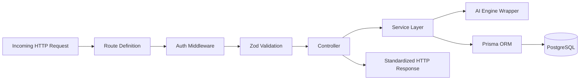
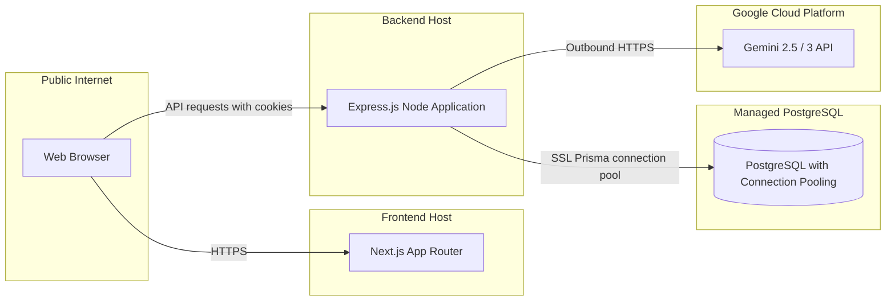

# System Architecture: CareerPilot AI

CareerPilot AI is a decoupled, multi-tier full-stack application: a **Next.js frontend**, a **modular Express.js REST API**, a **PostgreSQL** database accessed through **Prisma ORM**, and a server-side **Google Gemini** integration.

---

## 1. High-Level Topology

```mermaid
graph TB
    subgraph Client Tier ["Client Tier (Browser)"]
        Browser["Next.js App Router / React UI"]
    end

    subgraph Edge ["Edge & Hosting"]
        EdgeRouter["Reverse Proxy / Hosting"]
    end

    subgraph Backend Tier ["Backend (Node.js / Express)"]
        CORS["CORS & Security Headers (Helmet)"]
        AuthMid["Cookie Auth & Session Middleware"]
        ValMid["Zod Input Validation Middleware"]
        Router["Express REST Router (/api/v1)"]

        subgraph Controllers ["Controller Layer"]
            ACtrl["Auth Controller"]
            RCtrl["Resume Controller"]
            JCtrl["Job Controller"]
            MCtrl["Analysis Controller"]
            RMCtrl["Roadmap Controller"]
        end

        subgraph Services ["Service & Business Logic Layer"]
            ASvc["Auth Service (Tokens & Hashing)"]
            RSvc["Resume Service"]
            MSvc["Matching & Gap Engine"]
            AISvc["Gemini Client Wrapper"]
            RMSvc["Roadmap Service"]
        end

        subgraph DataAccess ["Prisma Data Access Layer"]
            PrismaClient["Prisma ORM Client & Transactions"]
        end
    end

    subgraph DataTier ["Persistent Data Tier"]
        Postgres[("PostgreSQL Database")]
    end

    subgraph External ["External AI Services"]
        GeminiAPI["Google Gemini Gen AI API"]
    end

    Browser <-->|HTTPS / Secure HttpOnly Cookies| EdgeRouter
    EdgeRouter <-->|REST API Calls (JSON)| CORS
    CORS --> AuthMid --> ValMid --> Router
    Router --> Controllers
    Controllers --> Services
    MSvc --> AISvc
    AISvc <-->|Server-to-Server HTTPS (API Key)| GeminiAPI
    Services --> PrismaClient
    PrismaClient <-->|Connection Pool / TCP| Postgres
```

---

## 2. Frontend / Backend Boundaries

| Tier | Technology | Responsibilities | Forbidden |
| :--- | :--- | :--- | :--- |
| **Frontend** | Next.js (App Router), React, TypeScript, Tailwind CSS | UI rendering, forms, interaction state; route protection; charts and skill badges; optimistic task updates. | Import `@google/genai` or call AI APIs from the browser; store JWTs in `localStorage`/`sessionStorage`; run direct database queries. |
| **Backend API** | Express.js, TypeScript, Node.js | CORS and origin validation; Zod payload validation; cookie authentication; ownership checks (`userId === record.userId`); transaction orchestration. | Expose raw database stack traces; log passwords, tokens, or full resume bodies in cleartext. |
| **Database & ORM** | PostgreSQL, Prisma ORM | Relational integrity via foreign keys and constraints; indexing; transaction rollbacks and atomic commits; structured entity storage. | Store unhashed passwords; leave foreign keys unindexed. |
| **AI Integration** | Google Gen AI SDK (`@google/genai`) | Receive sanitized prompts from the matching service; enforce structured JSON responses via SDK schemas; provide semantic extraction and bullet-point improvements. | Persist unvalidated LLM output without schema verification. |

---

## 3. Modular Backend Architecture

The backend is layered to keep responsibilities separate and testable:

```
backend/
├── src/
│   ├── config/              # Environment parsing and type-safe configuration
│   ├── middleware/          # Express middlewares (auth, validate, errorHandler)
│   ├── routes/              # Route mapping and middleware chaining (/api/v1/...)
│   ├── controllers/         # HTTP transport layer (parsing requests, status codes)
│   ├── services/            # Business logic and AI orchestration
│   ├── schemas/             # Zod validation schemas for requests and AI responses
│   ├── lib/                 # Shared singletons (prisma.ts, gemini.ts, logger.ts, ...)
│   └── types/               # TypeScript type definitions and interfaces
```

### 3.1 Layer Responsibilities & Data Flow



1. **Routes (`routes/*.routes.ts`):** Bind URL paths and verbs to middleware and controllers. No business logic.
2. **Middleware (`middleware/*.ts`):**
   - `authenticate.ts`: Extracts the HttpOnly session token, verifies it, and attaches `req.user = { id, email, role }`.
   - `validate.ts`: Higher-order middleware that validates `req.body`, `req.query`, or `req.params` against a Zod schema. Returns `400 Bad Request` with field-level issues on failure.
   - `errorHandler.ts`: Central error middleware that maps thrown errors (including Zod and Prisma errors) to HTTP status codes and redacts internals.
3. **Controllers (`controllers/*.controller.ts`):** Extract validated parameters, call the service method, and format the response:
   ```json
   {
     "success": true,
     "data": { "...": "..." },
     "meta": { "timestamp": "2026-10-17T21:00:00.000Z" }
   }
   ```
4. **Services (`services/*.service.ts`):** Hold the domain logic, calculation algorithms, transaction coordination, and AI orchestration. They do not touch Express `req`/`res`, which keeps them unit-testable.

---

## 4. Authentication & Security Lifecycle

### 4.1 Strategy comparison

| Strategy | Mechanism | Advantages | Trade-offs | Outcome |
| :--- | :--- | :--- | :--- | :--- |
| **Stateless JWT in localStorage** | Token sent via `Authorization: Bearer <token>` | Easy to implement; works across domains without cookie config. | Accessible to client-side JavaScript; vulnerable to XSS exfiltration. (Used in old repo). | Rejected |
| **Server-side stateful sessions** | Opaque session ID in an HttpOnly cookie; session looked up per request. | Instant revocation; no client-side token exposure. | Requires a centralized session store or heavy session writes; unnecessary for the MVP. | Rejected for MVP |
| **HttpOnly cookie JWT + refresh-token rotation** | Short-lived signed JWT in an HttpOnly, SameSite=Lax cookie plus a refresh token stored in PostgreSQL. | Immune to JavaScript token theft; cheap per-request verification; instant refresh revocation via DB lookup. | Requires CORS `credentials: true` and CSRF awareness. | Selected |

### 4.2 Authentication flow

```mermaid
sequenceDiagram
    autonumber
    actor User as Client (Next.js)
    participant AuthAPI as Express Auth Service
    participant DB as PostgreSQL (Prisma)

    Note over User,AuthAPI: Registration & login
    User->>AuthAPI: POST /api/v1/auth/login { email, password }
    AuthAPI->>DB: Query user by email
    DB-->>AuthAPI: User record with password hash
    AuthAPI->>AuthAPI: Verify bcrypt password hash
    AuthAPI->>AuthAPI: Generate short-lived Access Token (15m) & Refresh Token (7d)
    AuthAPI->>DB: Save hashed Refresh Token
    AuthAPI-->>User: Set-Cookie access_token & refresh_token (HttpOnly; Secure; SameSite=Lax)<br>HTTP 200 OK { user }
    Note over User,AuthAPI: Authenticated request
    User->>AuthAPI: GET /api/v1/resumes (cookies sent automatically)
    AuthAPI->>AuthAPI: Verify JWT signature & expiration
    AuthAPI->>DB: Fetch resumes where userId = req.user.id
    DB-->>AuthAPI: User resumes
    AuthAPI-->>User: HTTP 200 OK { data: resumes }
    Note over User,AuthAPI: Token refresh
    User->>AuthAPI: POST /api/v1/auth/refresh
    AuthAPI->>DB: Validate refresh token exists and is not revoked
    AuthAPI->>AuthAPI: Issue new access token + rotate refresh token
    AuthAPI->>DB: Revoke old refresh token, store new one
    AuthAPI-->>User: Updated Set-Cookie headers + HTTP 200 OK
```

### 4.3 Multi-tenant data isolation

Every model holding private user data (`Resume`, `JobDescription`, `ResumeAnalysis`, `CareerRoadmap`) has a mandatory `userId` foreign key. Controllers never trust a user ID passed in a request body or query. The `req.user.id` resolved from the verified cookie is injected into Prisma queries:

```typescript
const analysis = await prisma.resumeAnalysis.findFirst({
  where: {
    id: analysisId,
    userId, // guarantees cross-tenant isolation
  },
});
if (!analysis) {
  throw new NotFoundError('Analysis not found');
}
```

---

## 5. Validation, Error Handling & Logging

### 5.1 Validation

Request bodies, route params, and query params are validated with Zod before reaching controller logic. Failures return `400 Bad Request` with a list of `{ field, issue }` entries. AI responses are validated against `resumeAnalysisResponseSchema` (in `backend/src/schemas/ai-response.schema.ts`) before any database write.

### 5.2 Error handling

Custom error classes extend a base `AppError`:

- `BadRequestError` (`400`) - validation and malformed input.
- `UnauthorizedError` (`401`) - missing or invalid authentication cookie.
- `ForbiddenError` (`403`) - valid auth but insufficient permissions.
- `NotFoundError` (`404`) - target entity does not exist or does not belong to the user.
- `ConflictError` (`409`) - state conflict, e.g. duplicate email.
- `AIServiceError` (`503`) - upstream Gemini failure or quota exhaustion.

The `errorHandler` middleware also maps Prisma error codes (e.g. `P2002` unique constraint, `P2025` record not found, `P2003` foreign-key violation) and sanitizes responses so internal stack traces are not returned in production.

### 5.3 Logging

The app uses a small structured JSON logger (`backend/src/lib/logger.ts`). Before writing, it redacts sensitive fields, including `password`, `passwordHash`, `token`, `accessToken`, `refreshToken`, `authorization`, `cookie`, `content`, `rawText`, `email`, `secret`, and `apiKey`. Only operational metadata (route, status code, user ID, latency) is logged.

---

## 6. Database Transactions

Several workflows write across multiple related rows and must stay consistent. These are wrapped in atomic **Prisma transactions** (`prisma.$transaction`):

1. **Resume analysis persistence:**
   - Create the resume (if submitted inline) and the `JobDescription`.
   - Create the `ResumeAnalysis` linking `resumeId` and `jobDescriptionId`.
   - Create the `AnalysisSkill` rows with their `matchType` (`MATCHED`, `MISSING_REQUIRED`, `MISSING_PREFERRED`).
   - If any write fails, the whole analysis rolls back.
2. **Roadmap generation:**
   - Create the `CareerRoadmap`.
   - Create all associated `RoadmapTask` rows.
   - Atomic rollback if any task fails.
3. **Task toggle:**
   - Update the task's `isCompleted` flag, then recount and update the roadmap's `completedTasks`/`totalTasks`.

---

## 7. Deployment Topology



### 7.1 CORS configuration

- `origin`: strictly the configured frontend origin (`FRONTEND_URL`, or `http://localhost:3000` in development).
- `credentials`: `true` (required for the browser to send and receive HttpOnly cookies).
- `methods`: `['GET', 'POST', 'PUT', 'PATCH', 'DELETE', 'OPTIONS']`.
- `allowedHeaders`: `['Content-Type', 'Authorization', 'X-Requested-With']`.

> A live public deployment is optional for this project; the stack runs locally via Docker Compose by default.
