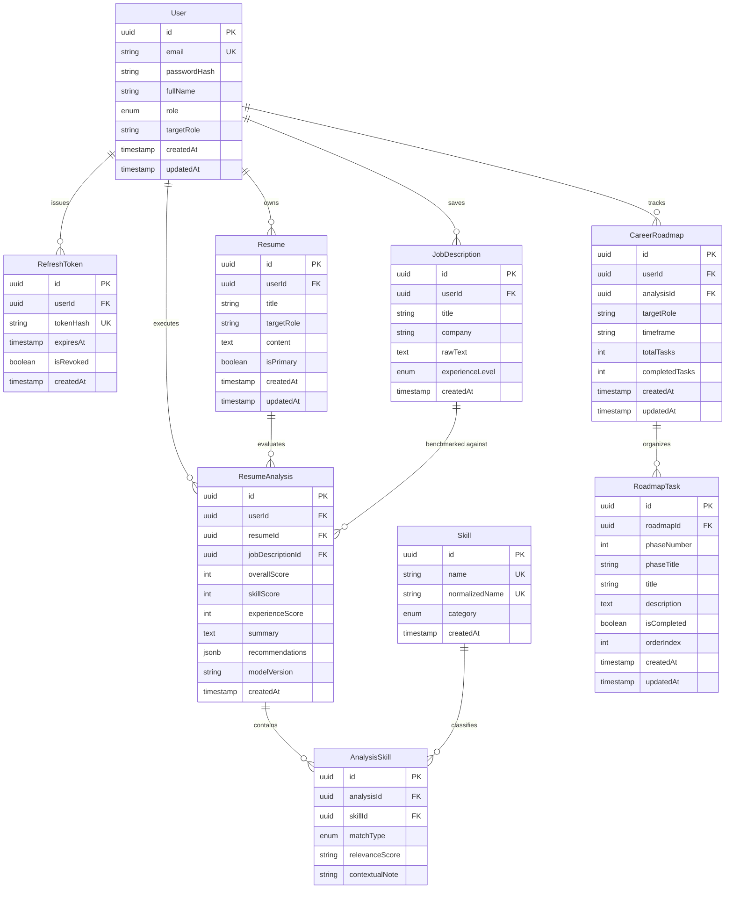

# Database Design Specification: CareerPilot AI

> **Database Engine:** PostgreSQL (Version 15+)  
> **ORM & Migration Tool:** Prisma ORM  
> **Document Purpose:** Relational Data Model Design & Schema Specification  
> **Author:** Senior Database Designer & Software Architect  
> **Version:** 1.0.0  
> **Status:** Approved for Implementation Planning  

---

## 1. Relational Modeling Strategy & Paradigm Shift

Unlike prior prototype architectures which used MongoDB document collections with unindexed relationships, missing foreign keys, and discarded data, **CareerPilot AI** is built on a strictly normalized **PostgreSQL** relational schema.

### 1.1 Core Design Principles
1. **Referential Integrity & Cascading Safety:** Every child entity (`Resume`, `JobDescription`, `ResumeAnalysis`, `CareerRoadmap`) maintains an indexed foreign key to its owning `User`. Deleting a user safely cascades to their private data, while critical historical analyses retain explicit integrity constraints.
2. **UUID Identifiers:** All primary keys utilize version 4 UUIDs (`@default(uuid())` or `gen_random_uuid()`) to prevent predictable ID enumeration attacks (OWASP IDOR defense).
3. **Normalized Master Skill Catalog:** Rather than storing unsearchable comma-separated skill strings in text blobs, skills are modeled as canonical records linked to analyses through a typed join entity (`AnalysisSkill`).
4. **Deliberate Use of JSONB:** JSONB is strictly restricted to semi-structured narrative recommendations and nested action plans where querying individual keys is unnecessary. Core metrics, skill mappings, completion flags, and relations are fully normalized into relational columns.

---

## 2. Entity-Relationship (ER) Diagram

---

## 3. Entity Specifications & Field Dictionaries

### 3.1 Model: `User`
Stores authenticated user accounts.

| Field Name | PostgreSQL Type | Prisma Attribute | Constraints & Description |
| :--- | :--- | :--- | :--- |
| `id` | `UUID` | `@id @default(uuid())` | Primary Key. |
| `email` | `VARCHAR(255)` | `@unique` | Normalized lowercase email; unique index. |
| `passwordHash` | `VARCHAR(255)` | — | Bcrypt hash (min cost factor 12). |
| `fullName` | `VARCHAR(100)` | — | User's full name. |
| `role` | `ENUM` | `@default(USER)` | Values: `USER`, `ADMIN`. |
| `targetRole` | `VARCHAR(100)` | `@nullable` | Optional career objective (e.g., "Full-Stack Engineer"). |
| `careerLevel` | `ENUM` | `@default(ENTRY)` | Values: `ENTRY`, `JUNIOR`, `MID`, `SENIOR`. |
| `createdAt` | `TIMESTAMPTZ` | `@default(now())` | Account creation timestamp. |
| `updatedAt` | `TIMESTAMPTZ` | `@updatedAt` | Automatic update timestamp. |

- **Relations:** 
  - `resumes`: 1-to-many `Resume[]` (cascade delete).
  - `jobDescriptions`: 1-to-many `JobDescription[]` (cascade delete).
  - `analyses`: 1-to-many `ResumeAnalysis[]` (cascade delete).
  - `roadmaps`: 1-to-many `CareerRoadmap[]` (cascade delete).
  - `refreshTokens`: 1-to-many `RefreshToken[]` (cascade delete).

---

### 3.2 Model: `RefreshToken`
Tracks active and rotated session refresh tokens for secure authentication.

| Field Name | PostgreSQL Type | Prisma Attribute | Constraints & Description |
| :--- | :--- | :--- | :--- |
| `id` | `UUID` | `@id @default(uuid())` | Primary Key. |
| `userId` | `UUID` | — | Foreign key referencing `User.id` (ON DELETE CASCADE). |
| `tokenHash` | `VARCHAR(255)` | `@unique` | SHA-256 hash of the issued refresh token. |
| `expiresAt` | `TIMESTAMPTZ` | — | Token expiry boundary (default: 7 days from issue). |
| `isRevoked` | `BOOLEAN` | `@default(false)` | Flag set upon logout or refresh token rotation. |
| `createdAt` | `TIMESTAMPTZ` | `@default(now())` | Issue timestamp. |

- **Indexes:** `CREATE INDEX idx_refresh_tokens_user_id ON refresh_tokens(user_id);`

---

### 3.3 Model: `Resume`
Stores candidate resumes submitted as structured text.

| Field Name | PostgreSQL Type | Prisma Attribute | Constraints & Description |
| :--- | :--- | :--- | :--- |
| `id` | `UUID` | `@id @default(uuid())` | Primary Key. |
| `userId` | `UUID` | — | Foreign key referencing `User.id` (ON DELETE CASCADE). |
| `title` | `VARCHAR(150)` | — | User-defined label (e.g., "Software Engineer Resume v2"). |
| `targetRole` | `VARCHAR(100)` | `@nullable` | Role this resume is tailored for. |
| `content` | `TEXT` | — | Raw or markdown resume text (100 to 20,000 characters). |
| `isPrimary` | `BOOLEAN` | `@default(false)` | Flag indicating primary default resume. |
| `createdAt` | `TIMESTAMPTZ` | `@default(now())` | Creation timestamp. |
| `updatedAt` | `TIMESTAMPTZ` | `@updatedAt` | Last modification timestamp. |

- **Indexes:** 
  - `CREATE INDEX idx_resumes_user_id ON resumes(user_id);`
  - `CREATE INDEX idx_resumes_user_primary ON resumes(user_id, is_primary);`

---

### 3.4 Model: `JobDescription`
Stores target job postings against which resumes are evaluated.

| Field Name | PostgreSQL Type | Prisma Attribute | Constraints & Description |
| :--- | :--- | :--- | :--- |
| `id` | `UUID` | `@id @default(uuid())` | Primary Key. |
| `userId` | `UUID` | — | Foreign key referencing `User.id` (ON DELETE CASCADE). |
| `title` | `VARCHAR(150)` | — | Job title (e.g., "Junior Backend Engineer"). |
| `company` | `VARCHAR(150)` | — | Company or organization name. |
| `experienceLevel`| `ENUM` | `@default(MID)` | Values: `ENTRY`, `JUNIOR`, `MID`, `SENIOR`, `LEAD`. |
| `rawText` | `TEXT` | — | Complete raw job posting text. |
| `createdAt` | `TIMESTAMPTZ` | `@default(now())` | Submission timestamp. |

- **Indexes:** `CREATE INDEX idx_job_descriptions_user_id ON job_descriptions(user_id);`

---

### 3.5 Model: `ResumeAnalysis`
Represents an executed gap analysis comparing a `Resume` to a `JobDescription`.

| Field Name | PostgreSQL Type | Prisma Attribute | Constraints & Description |
| :--- | :--- | :--- | :--- |
| `id` | `UUID` | `@id @default(uuid())` | Primary Key. |
| `userId` | `UUID` | — | Foreign key referencing `User.id` (ON DELETE CASCADE). |
| `resumeId` | `UUID` | — | Foreign key referencing `Resume.id` (ON DELETE RESTRICT). |
| `jobDescriptionId` | `UUID` | — | Foreign key referencing `JobDescription.id` (ON DELETE RESTRICT). |
| `overallScore` | `SMALLINT` | — | Normalized alignment score: `0 <= overallScore <= 100`. |
| `skillScore` | `SMALLINT` | — | Hard skill match score: `0 <= skillScore <= 100`. |
| `experienceScore` | `SMALLINT` | — | Seniority & experience depth score: `0 <= experienceScore <= 100`. |
| `summary` | `TEXT` | — | High-level executive synthesis generated by AI. |
| `recommendations` | `JSONB` | — | Structured array of actionable suggestions and bullet rewrites. |
| `modelVersion` | `VARCHAR(50)` | — | Gemini model identifier (e.g., `gemini-2.5-flash`). |
| `createdAt` | `TIMESTAMPTZ` | `@default(now())` | Execution timestamp. |

- **Check Constraints:** 
  - `overall_score >= 0 AND overall_score <= 100`
  - `skill_score >= 0 AND skill_score <= 100`
  - `experience_score >= 0 AND experience_score <= 100`
- **Indexes:** 
  - `CREATE INDEX idx_analyses_user_id ON resume_analyses(user_id);`
  - `CREATE INDEX idx_analyses_resume_job ON resume_analyses(resume_id, job_description_id);`

---

### 3.6 Model: `Skill` & `AnalysisSkill` (Normalized Skill Taxonomy)
Deconstructs skills into canonical entities and tracks their evaluation per analysis.

#### `Skill`
| Field Name | PostgreSQL Type | Prisma Attribute | Constraints & Description |
| :--- | :--- | :--- | :--- |
| `id` | `UUID` | `@id @default(uuid())` | Primary Key. |
| `name` | `VARCHAR(100)` | `@unique` | Display name (e.g., "TypeScript"). |
| `normalizedName` | `VARCHAR(100)` | `@unique` | Lowercase canonical token (e.g., "typescript"). |
| `category` | `ENUM` | — | Values: `LANGUAGE`, `FRAMEWORK`, `DATABASE`, `DEVOPS`, `CONCEPT`, `TOOL`. |
| `createdAt` | `TIMESTAMPTZ` | `@default(now())` | Creation timestamp. |

#### `AnalysisSkill` (Join Model)
| Field Name | PostgreSQL Type | Prisma Attribute | Constraints & Description |
| :--- | :--- | :--- | :--- |
| `id` | `UUID` | `@id @default(uuid())` | Primary Key. |
| `analysisId` | `UUID` | — | Foreign key referencing `ResumeAnalysis.id` (ON DELETE CASCADE). |
| `skillId` | `UUID` | — | Foreign key referencing `Skill.id` (ON DELETE RESTRICT). |
| `matchType` | `ENUM` | — | Values: `MATCHED`, `MISSING_REQUIRED`, `MISSING_PREFERRED`. |
| `relevance` | `ENUM` | `@default(HIGH)` | Values: `HIGH`, `MEDIUM`, `LOW`. |
| `contextualNote` | `VARCHAR(255)` | `@nullable` | Short excerpt or rationale (e.g., "Required for REST API service"). |

- **Indexes:** 
  - `CREATE UNIQUE INDEX uq_analysis_skill ON analysis_skills(analysis_id, skill_id);`
  - `CREATE INDEX idx_analysis_skills_match ON analysis_skills(analysis_id, match_type);`

---

### 3.7 Model: `CareerRoadmap` & `RoadmapTask`
Persists tailored learning plans derived from identified skill gaps.

#### `CareerRoadmap`
| Field Name | PostgreSQL Type | Prisma Attribute | Constraints & Description |
| :--- | :--- | :--- | :--- |
| `id` | `UUID` | `@id @default(uuid())` | Primary Key. |
| `userId` | `UUID` | — | Foreign key referencing `User.id` (ON DELETE CASCADE). |
| `analysisId` | `UUID` | `@nullable` | Optional foreign key referencing `ResumeAnalysis.id`. |
| `targetRole` | `VARCHAR(100)` | — | Target career objective (e.g., "Backend Engineer"). |
| `timeframe` | `VARCHAR(50)` | — | Planned duration (e.g., "3 Months", "6 Months"). |
| `totalTasks` | `INT` | `@default(0)` | Computed task count. |
| `completedTasks` | `INT` | `@default(0)` | Computed completed task count. |
| `createdAt` | `TIMESTAMPTZ` | `@default(now())` | Creation timestamp. |
| `updatedAt` | `TIMESTAMPTZ` | `@updatedAt` | Modification timestamp. |

#### `RoadmapTask`
| Field Name | PostgreSQL Type | Prisma Attribute | Constraints & Description |
| :--- | :--- | :--- | :--- |
| `id` | `UUID` | `@id @default(uuid())` | Primary Key. |
| `roadmapId` | `UUID` | — | Foreign key referencing `CareerRoadmap.id` (ON DELETE CASCADE). |
| `phaseNumber` | `SMALLINT` | — | Sequence index (e.g., 1 for Phase 1, 2 for Phase 2). |
| `phaseTitle` | `VARCHAR(150)` | — | Phase title (e.g., "Phase 1: Relational Database Foundations"). |
| `title` | `VARCHAR(200)` | — | Specific task title (e.g., "Design Prisma Schema with PostgreSQL"). |
| `description` | `TEXT` | `@nullable` | Detailed learning guidance and suggested project. |
| `isCompleted` | `BOOLEAN` | `@default(false)` | Completion toggle state. |
| `orderIndex` | `SMALLINT` | — | Ordering within the phase. |
| `createdAt` | `TIMESTAMPTZ` | `@default(now())` | Creation timestamp. |
| `updatedAt` | `TIMESTAMPTZ` | `@updatedAt` | Timestamp of state change. |

- **Indexes:** `CREATE INDEX idx_roadmap_tasks_roadmap_phase ON roadmap_tasks(roadmap_id, phase_number, order_index);`

---

## 4. Architectural Justification: Normalized Relational vs. JSONB

| Data Dimension | Selected Storage Format | Technical Justification |
| :--- | :--- | :--- |
| **User Accounts & Auth** | Strictly Normalized Relational | Critical security boundaries, unique email indexes, password hashes, and foreign keys require relational ACID guarantees. |
| **Resumes & Job Postings** | Normalized Relational (`TEXT` columns) | Resumes and job descriptions are standalone entities requiring ownership tracking, timestamps, and relational foreign keys. |
| **Skills & Match Classifications** | Normalized Relational (`Skill`, `AnalysisSkill`) | Modeling skills as relational rows enables cross-analysis querying (e.g., "Which skills are most commonly missing across all target jobs?"), aggregation, and taxonomy standardization. Storing skills inside a JSON blob would make SQL aggregation prohibitively expensive. |
| **Detailed Recommendations** | `JSONB` in `ResumeAnalysis.recommendations` | Recommendations are hierarchical, heterogeneous arrays of text rewrites (e.g., `[{ "category": "impact", "original": "...", "improved": "...", "rationale": "..." }]`). They are always read and displayed together as a unit and never queried independently. JSONB provides flexible structured storage without over-fragmenting the schema. |
| **Roadmap Tasks** | Strictly Normalized Relational (`RoadmapTask`) | Each task requires individual state mutation (`PATCH /tasks/:id`), completion timestamps, and aggregation for progress calculations (`completedTasks / totalTasks`). |

---

## 5. Migration Strategy & Seed Data

### 5.1 Prisma Migration Workflow
1. Schema is defined in `prisma/schema.prisma` and applied via a version-controlled migration.
2. Migration files are generated using `npx prisma migrate dev --name init_schema`.
3. Production migration execution via `npx prisma migrate deploy` before starting the backend process.

### 5.2 Deterministic Seeding (`prisma/seed.ts`)
To ensure predictable local development and live assessment demonstrations, the seed routine (`npm run db:seed`) populates:
- **Canonical Skill Taxonomy:** 73 software engineering skills across languages, frameworks, databases, DevOps tools, concepts, and tooling (idempotent `upsert` via `syncCanonicalSkills`).
- **Demo User:** The `demo@careerpilot.internal` reviewer account with a securely pre-hashed password for one-click assessment evaluation.
- **Reference Resume & Job Description Pair:** A realistic Junior Full-Stack developer resume and matching job description, pre-loaded for the demo account to demonstrate immediate end-to-end functionality.
