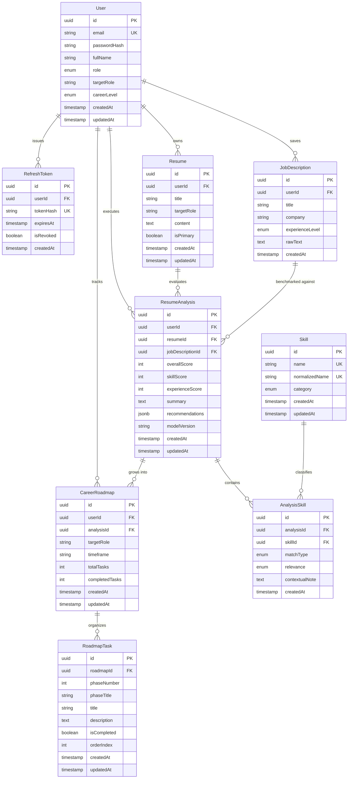

# Database Design: CareerPilot AI

**Engine:** PostgreSQL 16
**ORM & migrations:** Prisma ORM

This document describes the relational data model.

---

## 1. Design Strategy

Unlike prior prototype architectures which used MongoDB document collections with unindexed relationships, missing foreign keys, and discarded data, CareerPilot AI is built on a strictly normalized **PostgreSQL** relational schema.

### 1.1 Core principles

1. **Referential integrity & cascading:** Every child entity (`Resume`, `JobDescription`, `ResumeAnalysis`, `CareerRoadmap`, `RoadmapTask`, `AnalysisSkill`) has an indexed foreign key to its parent. Deleting a user or a parent record cascades to dependents.
2. **UUID identifiers:** All primary keys use v4 UUIDs (`@default(uuid())`) to avoid predictable ID enumeration.
3. **Normalized skill catalog:** Skills are canonical records linked to analyses through a typed join entity (`AnalysisSkill`) rather than comma-separated text blobs.
4. **Deliberate use of JSONB:** JSONB is used only for the semi-structured `recommendations` array, which is always read as a unit. Core metrics, skill mappings, completion flags, and relations are fully normalized into relational columns.

---

## 2. Entity-Relationship Diagram

---

## 3. Models

### 3.1 `User`

Stores authenticated accounts.

| Field | PostgreSQL type | Prisma | Notes |
| :--- | :--- | :--- | :--- |
| `id` | `UUID` | `@id @default(uuid())` | Primary key. |
| `email` | `VARCHAR(255)` | `@unique` | Lowercase email; unique. |
| `passwordHash` | `VARCHAR(255)` | `@map("password_hash")` | bcrypt hash (cost 12). |
| `fullName` | `VARCHAR(100)` | `@map("full_name")` | Display name. |
| `role` | `user_role` | `@default(USER)` | `USER`, `ADMIN`. |
| `targetRole` | `VARCHAR(100)` | `@nullable` | Optional career objective. |
| `careerLevel` | `career_level` | `@default(ENTRY)` | `ENTRY`, `JUNIOR`, `MID`, `SENIOR`. |
| `createdAt` | `TIMESTAMPTZ` | `@default(now())` | |
| `updatedAt` | `TIMESTAMPTZ` | `@updatedAt` | |

Relations: `refreshTokens`, `resumes`, `jobDescriptions`, `resumeAnalyses`, `careerRoadmaps` (all 1-to-many, cascade delete).

### 3.2 `RefreshToken`

Active and rotated refresh tokens.

| Field | PostgreSQL type | Prisma | Notes |
| :--- | :--- | :--- | :--- |
| `id` | `UUID` | `@id @default(uuid())` | Primary key. |
| `userId` | `UUID` | `@map("user_id")` | FK to `User.id` (CASCADE). |
| `tokenHash` | `VARCHAR(255)` | `@unique` | SHA-256 hash of the issued token. |
| `expiresAt` | `TIMESTAMPTZ` | `@map("expires_at")` | Expiry (7 days from issue). |
| `isRevoked` | `BOOLEAN` | `@default(false)` | Set on logout or rotation. |
| `createdAt` | `TIMESTAMPTZ` | `@default(now())` | |

Indexes: `idx_refresh_tokens_user_id`.

### 3.3 `Resume`

Candidate resumes stored as text.

| Field | PostgreSQL type | Prisma | Notes |
| :--- | :--- | :--- | :--- |
| `id` | `UUID` | `@id @default(uuid())` | Primary key. |
| `userId` | `UUID` | `@map("user_id")` | FK to `User.id` (CASCADE). |
| `title` | `VARCHAR(150)` | | User-defined label. |
| `targetRole` | `VARCHAR(100)` | `@nullable` | Role the resume is tailored for. |
| `content` | `TEXT` | | Resume text (100-20,000 characters). |
| `isPrimary` | `BOOLEAN` | `@default(false)` | Default resume flag. |
| `createdAt` / `updatedAt` | `TIMESTAMPTZ` | | |

Indexes: `idx_resumes_user_id`, `idx_resumes_user_primary` on `(user_id, is_primary)`.

### 3.4 `JobDescription`

Target job postings evaluated against.

| Field | PostgreSQL type | Prisma | Notes |
| :--- | :--- | :--- | :--- |
| `id` | `UUID` | `@id @default(uuid())` | Primary key. |
| `userId` | `UUID` | `@map("user_id")` | FK to `User.id` (CASCADE). |
| `title` | `VARCHAR(150)` | | Job title. |
| `company` | `VARCHAR(150)` | | Company name. |
| `experienceLevel` | `experience_level` | `@default(MID)` | `ENTRY`, `JUNIOR`, `MID`, `SENIOR`, `LEAD`. |
| `rawText` | `TEXT` | | Full posting text. |
| `createdAt` | `TIMESTAMPTZ` | `@default(now())` | |

Indexes: `idx_job_descriptions_user_id`.

### 3.5 `ResumeAnalysis`

An executed gap analysis comparing a resume to a job description.

| Field | PostgreSQL type | Prisma | Notes |
| :--- | :--- | :--- | :--- |
| `id` | `UUID` | `@id @default(uuid())` | Primary key. |
| `userId` | `UUID` | `@map("user_id")` | FK to `User.id` (CASCADE). |
| `resumeId` | `UUID` | `@map("resume_id")` | FK to `Resume.id` (CASCADE). |
| `jobDescriptionId` | `UUID` | `@map("job_description_id")` | FK to `JobDescription.id` (CASCADE). |
| `overallScore` | `SMALLINT` | `@map("overall_score")` | 0-100 (clamped in the reconciliation service). |
| `skillScore` | `SMALLINT` | `@map("skill_score")` | 0-100. |
| `experienceScore` | `SMALLINT` | `@map("experience_score")` | 0-100. |
| `summary` | `TEXT` | | AI-generated synthesis. |
| `recommendations` | `JSONB` | | Structured array of recommendations and bullet rewrites. |
| `modelVersion` | `VARCHAR(50)` | `@map("model_version")` | e.g. `hybrid-v1:gemini-2.5-flash`. |
| `createdAt` / `updatedAt` | `TIMESTAMPTZ` | | |

Indexes: `idx_resume_analyses_user_id`, `idx_resume_analyses_resume_id`, `idx_resume_analyses_job_description_id`, `idx_resume_analyses_user_created_at` on `(user_id, created_at)`.

> Score bounds are enforced in application code (the reconciliation service clamps values to 0-100 and the LLM response schema validates the range); there are no database `CHECK` constraints.

### 3.6 `Skill` & `AnalysisSkill`

Skills are canonical entities; their evaluation per analysis is tracked in the join table.

**`Skill`**

| Field | PostgreSQL type | Prisma | Notes |
| :--- | :--- | :--- | :--- |
| `id` | `UUID` | `@id @default(uuid())` | Primary key. |
| `name` | `VARCHAR(100)` | `@unique` | Display name, e.g. "TypeScript". |
| `normalizedName` | `VARCHAR(100)` | `@unique @map("normalized_name")` | Lowercase token, e.g. "typescript". |
| `category` | `skill_category` | | `LANGUAGE`, `FRAMEWORK`, `DATABASE`, `DEVOPS`, `CONCEPT`, `TOOL`. |
| `createdAt` / `updatedAt` | `TIMESTAMPTZ` | | |

Indexes: `idx_skills_category`.

**`AnalysisSkill`** (join model)

| Field | PostgreSQL type | Prisma | Notes |
| :--- | :--- | :--- | :--- |
| `id` | `UUID` | `@id @default(uuid())` | Primary key. |
| `analysisId` | `UUID` | `@map("analysis_id")` | FK to `ResumeAnalysis.id` (CASCADE). |
| `skillId` | `UUID` | `@map("skill_id")` | FK to `Skill.id` (CASCADE). |
| `matchType` | `match_type` | `@map("match_type")` | `MATCHED`, `MISSING_REQUIRED`, `MISSING_PREFERRED`. |
| `relevance` | `skill_relevance` | `@default(MEDIUM)` | `HIGH`, `MEDIUM`, `LOW`. |
| `contextualNote` | `TEXT` | `@nullable @map("contextual_note")` | Short rationale or excerpt. |
| `createdAt` | `TIMESTAMPTZ` | `@default(now())` | |

Indexes: unique `uq_analysis_skills_analysis_skill` on `(analysis_id, skill_id)`, `idx_analysis_skills_analysis_id`, `idx_analysis_skills_skill_id`, `idx_analysis_skills_match_type`.

### 3.7 `CareerRoadmap` & `RoadmapTask`

Learning plans derived from identified gaps.

**`CareerRoadmap`**

| Field | PostgreSQL type | Prisma | Notes |
| :--- | :--- | :--- | :--- |
| `id` | `UUID` | `@id @default(uuid())` | Primary key. |
| `userId` | `UUID` | `@map("user_id")` | FK to `User.id` (CASCADE). |
| `analysisId` | `UUID` | `@map("analysis_id")` | FK to `ResumeAnalysis.id` (CASCADE); required. |
| `targetRole` | `VARCHAR(100)` | `@map("target_role")` | Target role. |
| `timeframe` | `VARCHAR(50)` | | e.g. "3 Months", "6 Months", "12 Months". |
| `totalTasks` | `INT` | `@default(0)` | Computed task count. |
| `completedTasks` | `INT` | `@default(0)` | Computed completed count. |
| `createdAt` / `updatedAt` | `TIMESTAMPTZ` | | |

Indexes: `idx_career_roadmaps_user_id`, `idx_career_roadmaps_analysis_id`, `idx_career_roadmaps_user_created_at` on `(user_id, created_at)`.

**`RoadmapTask`**

| Field | PostgreSQL type | Prisma | Notes |
| :--- | :--- | :--- | :--- |
| `id` | `UUID` | `@id @default(uuid())` | Primary key. |
| `roadmapId` | `UUID` | `@map("roadmap_id")` | FK to `CareerRoadmap.id` (CASCADE). |
| `phaseNumber` | `SMALLINT` | `@map("phase_number")` | Phase index. |
| `phaseTitle` | `VARCHAR(150)` | `@map("phase_title")` | Phase title. |
| `title` | `VARCHAR(200)` | | Task title. |
| `description` | `TEXT` | | Learning guidance for the task. |
| `isCompleted` | `BOOLEAN` | `@default(false)` | Completion toggle. |
| `orderIndex` | `SMALLINT` | `@map("order_index")` | Ordering within the phase. |
| `createdAt` / `updatedAt` | `TIMESTAMPTZ` | | |

Indexes: `idx_roadmap_tasks_roadmap_id`, `idx_roadmap_tasks_roadmap_order` on `(roadmap_id, order_index)`, `idx_roadmap_tasks_roadmap_phase` on `(roadmap_id, phase_number)`.

---

## 4. Why Relational vs. JSONB

| Data | Storage | Reason |
| :--- | :--- | :--- |
| **Accounts & auth** | Normalized relational | Security boundaries, unique email, password hashes, and foreign keys rely on ACID guarantees. |
| **Resumes & job postings** | Normalized relational (`TEXT`) | Standalone entities needing ownership, timestamps, and foreign keys. |
| **Skills & match classifications** | Normalized (`Skill`, `AnalysisSkill`) | Enables cross-analysis querying and aggregation (e.g. "which skills are most commonly missing"). A JSON blob would make that expensive. |
| **Recommendations** | `JSONB` | A heterogeneous array of rewrites always read as a unit; never queried by key. |
| **Roadmap tasks** | Normalized (`RoadmapTask`) | Each task is mutated individually and aggregated for progress. |

---

## 5. Migration & Seed Data

### 5.1 Migration workflow

1. The schema is defined in `backend/prisma/schema.prisma`.
2. Migrations are generated with `npx prisma migrate dev --name <name>`.
3. Production migrations run via `npx prisma migrate deploy` before the backend starts.

### 5.2 Seeding (`prisma/seed.ts`)

`npm run db:seed` (idempotent `upsert`) populates:

- **Canonical skill taxonomy:** 73 engineering skills across languages, frameworks, databases, DevOps, concepts, and tooling.
- **Demo user:** the `demo@careerpilot.internal` reviewer account with a pre-hashed password.
- **Reference resume and job description pair:** a realistic junior full-stack resume and a matching posting, pre-loaded for the demo account so the flow works immediately.
