# Implementation Plan: CareerPilot AI

This document records the phased plan the project was built against, including the commit conventions and the definition of done for each phase.

---

## 1. Approach

1. **Vertical slices:** complete the database, auth, and resume-job matching workflow end-to-end before secondary features like roadmaps.
2. **Test alongside code:** every core endpoint gets integration tests written with the controller and service.
3. **Small commits:** keep commits self-contained and semantically tagged (e.g. `feat(auth):`, `test(matching):`, `fix(security):`).

```mermaid
gantt
    title CareerPilot AI implementation sequence
    dateFormat  X
    axisFormat %d

    section Foundation
    Phase 1: Project scaffolding        :p1, 0, 1
    Phase 2: Database & Prisma          :p2, after p1, 1

    section Backend Core
    Phase 3: Auth & security            :p3, after p2, 1
    Phase 4: Resumes & jobs APIs        :p4, after p3, 1
    Phase 5: AI matching                :p5, after p4, 2

    section Frontend & Polish
    Phase 6: Next.js UI & match flow    :p6, after p5, 2
    Phase 7: Roadmaps & task state      :p7, after p6, 1
    Phase 8: Tests & security review    :p8, after p7, 1
    Phase 9: Deployment & verification  :p9, after p8, 1
```

---

## 2. Phases

### Phase 1: Project Scaffolding & Toolchain Setup
- **Goal:** a clean two-package structure (`frontend/`, `backend/`) with strict TypeScript and linting.
- **Tasks:**
  - [x] 1.1 Initialize the root workspace in `CareerPilot-AI`.
  - [x] 1.2 Scaffold the Express backend and install dependencies (`express`, `cors`, `helmet`, `cookie-parser`, `dotenv`, `zod`, `jsonwebtoken`, `bcryptjs`, `@google/genai`, `@prisma/client`).
  - [x] 1.3 Install backend dev dependencies (`typescript`, `tsx`, `prisma`, `vitest`, `supertest`, `@types/*`).
  - [x] 1.4 Scaffold the Next.js frontend (TypeScript, Tailwind, App Router).
  - [x] 1.5 Configure `.env.example` in both packages.
- **Commit:** `chore: initialize frontend and backend scaffolding with strict typescript`
- **Done when:** `npm run dev` works in both packages on ports `5000` and `3000`.

### Phase 2: PostgreSQL Schema, Prisma Models & Migrations
- **Goal:** translate the relational design into an active PostgreSQL schema via Prisma.
- **Dependencies:** Phase 1, a database connection string.
- **Tasks:**
  - [x] 2.1 Initialize Prisma (`npx prisma init`).
  - [x] 2.2 Define models in `schema.prisma`: `User`, `RefreshToken`, `Resume`, `JobDescription`, `ResumeAnalysis`, `Skill`, `AnalysisSkill`, `CareerRoadmap`, `RoadmapTask`.
  - [x] 2.3 Configure indexes and cascading rules.
  - [x] 2.4 Run the initial migration (`npx prisma migrate dev --name init_schema`).
  - [x] 2.5 Create `prisma/seed.ts` to populate the canonical skill taxonomy and the demo account.
- **Commit:** `feat(database): implement prisma schema, relations, indexes, and seed routine`
- **Done when:** `npm run db:seed` runs successfully and Prisma Studio shows all tables.

### Phase 3: Secure Authentication & Authorization
- **Goal:** HttpOnly cookie auth with refresh-token rotation and ownership validation.
- **Dependencies:** Phase 2.
- **Tasks:**
  - [x] 3.1 Password hashing with bcrypt (cost 12).
  - [x] 3.2 JWT signing and cookie issuance (`access_token` 15m, `refresh_token` 7d).
  - [x] 3.3 `authenticate` middleware that verifies the cookie JWT and populates `req.user`.
  - [x] 3.4 Routes: `POST /api/v1/auth/register`, `/login`, `/demo`, `/refresh`, `/logout`, and `GET /auth/me`.
  - [x] 3.5 Auth tests via Supertest against an isolated test database.
- **Commit:** `feat(auth): implement secure httponly cookie auth and token rotation`
- **Done when:** tests pass for registration, login, cookie setting, refresh rotation, and unauthorized rejection.

### Phase 4: Core Domain APIs (Resumes & Job Descriptions)
- **Goal:** validated CRUD services and controllers for resumes and job descriptions.
- **Dependencies:** Phase 3.
- **Tasks:**
  - [x] 4.1 Zod schemas for resume and job create/update.
  - [x] 4.2 `resumes.service.ts` and `resumes.controller.ts` with ownership filters (`userId: req.user.id`).
  - [x] 4.3 `jobs.service.ts` and `jobs.controller.ts`.
  - [x] 4.4 Mount routes under `/api/v1/resumes` and `/api/v1/jobs`.
  - [x] 4.5 Integration tests verifying cross-tenant isolation.
- **Commit:** `feat(domain): add resume and job description apis with multi-tenant ownership checks`
- **Done when:** resumes and jobs can be created, fetched, updated, and deleted with verified ownership.

### Phase 5: AI Matching & Skill Gap Engine
- **Goal:** hybrid deterministic + Gemini matching with schema validation and relational persistence.
- **Dependencies:** Phase 4, a Gemini API key.
- **Tasks:**
  - [x] 5.1 Deterministic skill extraction (`matching.deterministic.ts`).
  - [x] 5.2 Gemini client wrapper (`lib/gemini.ts`) with `responseSchema` and fallback retry logic.
  - [x] 5.3 Reconciliation and scoring (`matching.reconciliation.ts`) plus atomic persistence (`analysis.service.ts`).
  - [x] 5.4 Build `POST /api/v1/analyses` and `GET /api/v1/analyses/:id` (plus list and delete).
  - [x] 5.5 Unit tests for the scoring formula and schema validation.
- **Commit:** `feat(ai): integrate gemini resume-job matching engine with structured persistence`
- **Done when:** an analysis returns a validated result, persists across the relational tables, and handles API errors cleanly.

### Phase 6: Next.js Frontend & Core User Journeys
- **Goal:** a responsive UI connected to the REST API.
- **Dependencies:** Phase 5.
- **Tasks:**
  - [x] 6.1 Axios client with `withCredentials: true` and a silent-refresh interceptor (`frontend/src/lib/api.ts`).
  - [x] 6.2 Auth context and route protection (`frontend/src/proxy.ts`).
  - [x] 6.3 Login, registration, and demo login pages.
  - [x] 6.4 Resume management and job ingestion views.
  - [x] 6.5 Gap analysis UI: dual input, loading state, score gauge, skill badges (green matched, red missing required, amber preferred), and a recommendations panel.
- **Commit:** `feat(frontend): build responsive next.js ui for auth, resumes, and gap analysis`
- **Done when:** a user can register, create a resume, run a job match, and review the visual breakdown on desktop and mobile.

### Phase 7: Career Roadmap & Task Management
- **Goal:** roadmap generation with toggleable, persistent tasks.
- **Dependencies:** Phase 6.
- **Tasks:**
  - [x] 7.1 Roadmap generation service that converts an analysis's skill gaps into phased tasks via Gemini.
  - [x] 7.2 `POST /api/v1/roadmaps`, `GET /api/v1/roadmaps/:id`, and `PATCH /api/v1/roadmaps/tasks/:taskId`.
  - [x] 7.3 Roadmap timeline view with completion toggles and a live progress bar.
- **Commit:** `feat(roadmap): implement phased learning roadmap and persistent task tracking`
- **Done when:** toggling a task updates the database and the progress bar.

### Phase 8: Testing & Security Review
- **Goal:** full automated verification and a security pass.
- **Dependencies:** Phase 7.
- **Tasks:**
  - [x] 8.1 End-to-end integration test: register -> create resume -> create job -> run analysis -> generate roadmap -> toggle task.
  - [x] 8.2 OWASP-oriented checks: no tokens in `localStorage`, CORS with credentials, parameterized Prisma queries, no client-side key exposure.
  - [x] 8.3 Verify no PII leaks in logs.
  - [x] 8.4 Run `typecheck` and `lint` across both packages.
- **Commit:** `test(e2e): add comprehensive api integration tests and security verification`
- **Done when:** all suites pass (`npm test`) with no TypeScript errors.

### Phase 9: Deployment & Verification
- **Goal:** run the full stack and (optionally) deploy it.
- **Dependencies:** Phase 8.
- **Status:** cloud deployment is optional. The app runs locally via Docker Compose (`docker compose up -d postgres`) plus `npm run dev`, with `npm run db:seed` for demo data.
- **Tasks:**
  - [x] 9.5 Seed the demo account and reference resume/job pair (`npm run db:seed`).
  - [ ] 9.1 Deploy PostgreSQL (Neon / Supabase) and run `prisma migrate deploy`.
  - [ ] 9.2 Deploy the Express backend (Render / Railway) with environment variables.
  - [ ] 9.3 Deploy the Next.js frontend (Vercel) with `NEXT_PUBLIC_API_URL` configured.
  - [ ] 9.4 Verify HTTPS CORS and cookie exchange between the deployed hosts.
- **Commit:** `chore(deploy): configure production deployment scripts and environment parameters`
- **Done when:** the app runs end-to-end locally (or via a public URL) and a reviewer can log in and complete a gap analysis.

---

## 3. Deliverables

| Item | Location | Verification |
| :--- | :--- | :--- |
| **Repository** | Clean conventional commits. | `git log --oneline` shows a modular progression. |
| **README & setup** | Step-by-step instructions for frontend, backend, and PostgreSQL. | Clone and run `npm run dev` in a few minutes. |
| **Env examples** | `backend/.env.example`, `frontend/.env.example`. | No secrets committed; placeholders provided. |
| **Demo credentials** | `demo@careerpilot.internal` / `DemoPassword123!`. | Pre-loaded with a demo resume and job posting. |
| **Deployment (optional)** | Frontend on Vercel, backend on Render/Railway if desired. | Verified HTTPS communication and cookie persistence when deployed. |
| **Local run** | `docker compose up -d postgres` -> `prisma migrate deploy` -> `npm run db:seed` -> `npm run dev`. | Runs on Node v20+. |

---

## 4. Live Demonstration Preparation

### 4.1 Demo sequence (about 5 minutes)
1. **Introduction:** the problem (opaque ATS rejections, vague feedback) and the value proposition.
2. **Demo login:** one-click login to reach the dashboard.
3. **Execution:** paste a job posting, select the stored resume, and run the analysis.
4. **Explain results:** walk through the three sub-scores (skills, experience, completeness), the missing-required badges, and a Google XYZ rewrite.
5. **Roadmap:** check off a task and show the progress update.

### 4.2 Architecture talking points
- **Database:** PostgreSQL over a document store for relational integrity and normalized `Skill` / `AnalysisSkill` joins.
- **Auth:** HttpOnly cookies with refresh rotation over `localStorage` JWTs, to avoid XSS token theft.
- **AI:** the hybrid approach (deterministic normalization plus LLM semantic reasoning) rather than a purely non-deterministic prompt.

### 4.3 Likely live changes
- **Change scoring weights:** edit `SCORE_WEIGHTS` in `backend/src/services/matching.reconciliation.ts` and rerun the matching unit tests.
- **Add a validation rule:** edit the relevant Zod schema in `backend/src/schemas/` and trigger a `400`.
- **Debug a query:** inspect Prisma error codes (e.g. `P2002`, `P2025`) and the error middleware.

---

## 5. Prioritization if Time Is Short

If the schedule tightens, keep the core loop and simplify the edges:

| Feature | Priority | If constrained |
| :--- | :---: | :--- |
| **Auth & security** | Critical | Keep. Secure cookies and validation are central. |
| **Relational DB & Prisma** | Critical | Keep. The normalized schema is a core requirement. |
| **Matching & scoring** | Critical | Keep. This is the flagship capability. |
| **Frontend UX states** | High | Keep the loading, empty, and error states polished. |
| **Roadmap task tracking** | High | Simplify to fewer phases if needed. |
| **Cover letter generation** | Medium | Defer; secondary to core matching. |
| **Complex dashboard charts** | Low | Simplify to metric cards (total resumes, latest score). |
