# Implementation Roadmap & Engineering Plan: CareerPilot AI

> **Target Platform:** CareerPilot AI  
> **Development Context:** Solo Full-Stack Developer Assessment Project  
> **Document Status:** Actionable Implementation Roadmap  
> **Author:** Senior Technical Planning Engineer & Software Architect  
> **Version:** 1.0.0  

---

> [!IMPORTANT]
> **Assessment Deadline Notice:**  
> The recruitment email and assignment documentation may indicate conflicting submission dates or time zones. **The final assessment submission deadline must be formally confirmed with the recruiting coordinator before locking final implementation milestones.** The plan below is structured in strict priority phases so that an assessment-ready, fully working end-to-end slice can be demonstrated at any checkpoint.

---

## 1. Development Methodology & Execution Strategy

To ensure a stress-free delivery that showcases senior-level engineering rigor:
1. **Vertical Slice Delivery:** Complete the core database, authentication, and Resume–Job Matching workflow end-to-end before touching secondary features like roadmaps or additional pages.
2. **Test-Driven Verification:** Every API endpoint must have automated integration tests written alongside controller and service development.
3. **Atomic Conventional Commits:** Keep Git commits small, self-contained, and semantically tagged (e.g., `feat(auth):`, `test(matching):`, `fix(security):`).

```mermaid
gantt
    title CareerPilot AI Implementation Sequence
    dateFormat  X
    axisFormat %d

    section Foundation
    Phase 0: Confirmation & Setup       :p0, 0, 1
    Phase 1: Project Scaffolding        :p1, after p0, 1d
    Phase 2: Database & Prisma          :p2, after p1, 1d

    section Backend Core
    Phase 3: Auth & Security            :p3, after p2, 1d
    Phase 4: Resumes & Jobs APIs        :p4, after p3, 1d
    Phase 5: Flagship AI Matching       :p5, after p4, 2d

    section Frontend & Polish
    Phase 6: Next.js UI & Match Flow    :p6, after p5, 2d
    Phase 7: Roadmaps & Task State      :p7, after p6, 1d
    Phase 8: Automated Tests & Security :p8, after p7, 1d
    Phase 9: Deployment & Verification  :p9, after p8, 1d
```

---

## 2. Phase-by-Phase Implementation Blueprint

### Phase 0: Requirements & Deadline Confirmation
- **Goal:** Lock scope, verify credentials, and confirm assessment delivery date.
- **Tasks:**
  - [ ] 0.1 Send formal deadline clarification email to recruiter/evaluator.
  - [ ] 0.2 Verify active Google Gemini API Key and PostgreSQL database access (Neon / Supabase).
  - [ ] 0.3 Confirm local Node.js (v20+ LTS) and Git toolchains.
- **Deliverable:** Confirmed deadline and active API credentials.

---

### Phase 1: Project Scaffolding & Toolchain Setup
- **Goal:** Establish a clean, decoupled monorepo or dual-package structure (`frontend/` and `backend/`) with strict TypeScript configuration and linting.
- **Tasks:**
  - [ ] 1.1 Initialize clean root workspace in `CareerPilot-AI`.
  - [ ] 1.2 Scaffold Express backend: `npm init -y`, install dependencies (`express`, `cors`, `helmet`, `cookie-parser`, `dotenv`, `zod`, `jsonwebtoken`, `bcryptjs`, `@google/genai`, `@prisma/client`).
  - [ ] 1.3 Install backend dev dependencies: `typescript`, `tsx`, `prisma`, `vitest`, `supertest`, `@types/*`.
  - [ ] 1.4 Scaffold Next.js frontend: `npx -y create-next-app@latest frontend --typescript --tailwind --app --eslint`.
  - [ ] 1.5 Configure `.env.example` in both directories with complete parameter documentation.
- **Git Commit Recommendation:** `chore: initialize frontend and backend scaffolding with strict typescript`
- **Definition of Done:** Both `npm run dev` in `backend` and `npm run dev` in `frontend` start without errors on ports `5000` and `3000`.

---

### Phase 2: PostgreSQL Schema, Prisma Models & Migrations
- **Goal:** Translate the relational architecture into an active PostgreSQL database schema via Prisma ORM.
- **Dependencies:** Phase 1, PostgreSQL connection string.
- **Tasks:**
  - [ ] 2.1 Initialize Prisma: `npx prisma init`.
  - [ ] 2.2 Define models in `schema.prisma`: `User`, `RefreshToken`, `Resume`, `JobDescription`, `ResumeAnalysis`, `Skill`, `AnalysisSkill`, `CareerRoadmap`, `RoadmapTask`.
  - [ ] 2.3 Configure indexes, check constraints, and cascading rules.
  - [ ] 2.4 Execute initial migration: `npx prisma migrate dev --name init_schema`.
  - [ ] 2.5 Create seed script `prisma/seed.ts` populating canonical skill taxonomy and a test demo account.
- **Git Commit Recommendation:** `feat(database): implement prisma schema, relations, indexes, and seed routine`
- **Definition of Done:** `npx prisma db seed` runs successfully and Prisma Studio displays all normalized tables.

---

### Phase 3: Secure Authentication & Authorization Middleware
- **Goal:** Implement secure httpOnly cookie authentication with refresh token rotation and resource ownership validation.
- **Dependencies:** Phase 2.
- **Tasks:**
  - [ ] 3.1 Implement password hashing utility with bcrypt (cost 12).
  - [ ] 3.2 Implement JWT signing and cookie issuance utility (`access_token` maxAge 15m, `refresh_token` maxAge 7d).
  - [ ] 3.3 Create `authenticate` middleware to verify cookie JWT and populate `req.user`.
  - [ ] 3.4 Build `POST /api/v1/auth/register`, `POST /api/v1/auth/login`, `POST /api/v1/auth/demo`, `POST /api/v1/auth/refresh`, and `POST /api/v1/auth/logout`.
  - [ ] 3.5 Write integration tests for auth endpoints using Supertest and an isolated test DB.
- **Git Commit Recommendation:** `feat(auth): implement secure httponly cookie auth and token rotation`
- **Definition of Done:** 100% passing tests for registration, login, cookie setting, and unauthorized access rejection.

---

### Phase 4: Core Domain APIs (Resumes & Job Descriptions)
- **Goal:** Build validated CRUD services and controllers for resume and job description management.
- **Dependencies:** Phase 3.
- **Tasks:**
  - [ ] 4.1 Define Zod schemas for resume and job creation/updates.
  - [ ] 4.2 Build `resumes.service.ts` and `resumes.controller.ts` with strict user ownership filters (`userId: req.user.id`).
  - [ ] 4.3 Build `jobs.service.ts` and `jobs.controller.ts`.
  - [ ] 4.4 Mount routes under `/api/v1/resumes` and `/api/v1/jobs`.
  - [ ] 4.5 Write Supertest integration tests verifying cross-tenant isolation (User A cannot read User B's resume).
- **Git Commit Recommendation:** `feat(domain): add resume and job description apis with multi-tenant ownership checks`
- **Definition of Done:** Resumes and jobs can be created, fetched, and deleted with verified ownership security.

---

### Phase 5: Flagship AI Integration (Matching & Skill Gap Engine)
- **Goal:** Implement the hybrid deterministic + Gemini matching engine with structured schema validation and relational persistence.
- **Dependencies:** Phase 4, Gemini API key.
- **Tasks:**
  - [ ] 5.1 Implement canonical skill regex/keyword extraction service (`matching.deterministic.ts`).
  - [ ] 5.2 Implement Gemini API wrapper (`gemini.service.ts`) with `responseSchema` and fallback retry logic.
  - [ ] 5.3 Implement `matching.service.ts` combining deterministic and LLM outputs, computing composite scores, and executing atomic `prisma.$transaction`.
  - [ ] 5.4 Build `POST /api/v1/analyses` and `GET /api/v1/analyses/:id`.
  - [ ] 5.5 Write unit tests for score calculation formula and schema validation.
- **Git Commit Recommendation:** `feat(ai): integrate gemini resume-job matching engine with structured persistence`
- **Definition of Done:** Submitting a resume and job posting returns a validated analysis, persists records across 4 relational tables, and handles API errors cleanly.

---

### Phase 6: Next.js Frontend Foundation & Core User Journeys
- **Goal:** Build a responsive, polished Next.js user interface connecting to the Express REST API.
- **Dependencies:** Phase 5.
- **Tasks:**
  - [ ] 6.1 Configure Axios/Fetch API client with `credentials: 'include'` to pass httpOnly cookies.
  - [ ] 6.2 Implement AuthContext and route protection middleware.
  - [ ] 6.3 Build Login, Registration, and Demo Login pages.
  - [ ] 6.4 Build Resume Management views (add resume, view resume).
  - [ ] 6.5 Build Flagship Match Analysis UI: dual-input form (Resume + Job Description), loading skeleton, interactive Match Score dial, skill breakdown badges (Green for Matched, Red for Missing Required, Yellow for Bonus), and actionable recommendations card.
- **Git Commit Recommendation:** `feat(frontend): build responsive next.js ui for auth, resumes, and gap analysis`
- **Definition of Done:** A user can register, create a resume, execute a job match analysis, and review the visual breakdown on desktop and mobile viewports.

---

### Phase 7: Career Roadmap & Task Management
- **Goal:** Provide actionable learning roadmap generation with toggleable task persistence.
- **Dependencies:** Phase 6.
- **Tasks:**
  - [ ] 7.1 Build backend roadmap generation service using Gemini to convert identified skill gaps into phased tasks.
  - [ ] 7.2 Implement `POST /api/v1/roadmaps` and `PATCH /api/v1/roadmaps/tasks/:taskId`.
  - [ ] 7.3 Build frontend Roadmap timeline view with interactive completion checkboxes and live progress bar.
- **Git Commit Recommendation:** `feat(roadmap): implement phased learning roadmap and persistent task tracking`
- **Definition of Done:** Completing a task updates the database and recalculates the visual progress bar dynamically.

---

### Phase 8: Automated Testing Suite & Security Review
- **Goal:** Ensure full automated test verification and run security vulnerability audits.
- **Dependencies:** Phase 7.
- **Tasks:**
  - [ ] 8.1 Write full end-to-end integration test: Register -> Create Resume -> Create Job -> Run Analysis -> Verify Persisted Records.
  - [ ] 8.2 Verify OWASP Top 10 defenses: No tokens in localStorage, CSRF defense verified, SQL injection impossible via Prisma parameterized queries, XSS protected.
  - [ ] 8.3 Verify zero PII in Morgan/Winston logs.
  - [ ] 8.4 Run `npm run typecheck` and `npm run lint` across frontend and backend packages.
- **Git Commit Recommendation:** `test(e2e): add comprehensive api integration tests and security verification`
- **Definition of Done:** All test suites pass cleanly (`npm test`), zero TypeScript compilation errors.

---

### Phase 9: Deployment, Seeding & Live Demonstration Preparation
- **Goal:** Deploy the full-stack system and prepare the assessment demonstration.
- **Dependencies:** Phase 8.
- **Tasks:**
  - [ ] 9.1 Deploy PostgreSQL database instance on Neon or Supabase; execute `prisma migrate deploy`.
  - [ ] 9.2 Deploy Express backend to Render / Railway; configure environment variables.
  - [ ] 9.3 Deploy Next.js frontend to Vercel; configure `NEXT_PUBLIC_API_URL`.
  - [ ] 9.4 Verify live HTTPS CORS and cookie exchange between Vercel and Render.
  - [ ] 9.5 Run live seed script creating the demo reviewer account.
- **Git Commit Recommendation:** `chore(deploy): configure production deployment scripts and environment parameters`
- **Definition of Done:** Live application loads at public URL; reviewer can log in with one click and run a complete gap analysis.

---

## 3. Assessment Deliverables & Submission Checklist

To score full marks on **Submission & Live Review (10 Marks)**:

| Requirement | Implementation Artifact / Location | Verification Method |
| :--- | :--- | :--- |
| **Git Repository** | Dedicated repository with clean conventional commits. | `git log --oneline` shows modular semantic progression. |
| **README & Setup** | Clear step-by-step installation instructions for frontend, backend, and PostgreSQL database. | Evaluator can clone and run `npm run dev` in under 3 minutes. |
| **Environment Examples** | `backend/.env.example` and `frontend/.env.example` documenting all configuration keys. | No secret keys committed; placeholder values provided. |
| **Demo Credentials** | Pre-seeded evaluation account: `demo@careerpilot.internal` / `DemoPassword123!`. | Pre-loaded with demo resume and sample job posting for instant review. |
| **Live Deployment** | Frontend on Vercel (`https://careerpilot-ai.vercel.app`) + Backend on Render/Railway. | Verified live HTTPS communication and cookie persistence. |
| **Local Run Fallback** | `npm run start` or `npm run dev` scripts functional out-of-the-box. | Verified local execution on Node v20+. |

---

## 4. Live Demonstration & Technical Defense Preparation

During the live assessment evaluation, be prepared to demonstrate and defend:

### 4.1 Live Demonstration Sequence (5 Minutes)
1. **Introduction:** State the problem (ATS black-box rejections, vague feedback) and product value proposition.
2. **Demo Login:** Use one-click demo login to show immediate dashboard state.
3. **Execution:** Paste a sample job posting, select the stored resume, and trigger the Match Analysis.
4. **Explain Results:** Explain the 3 sub-scores (Skills, Experience, Completeness), point out the missing required skills badges, and review the Google XYZ bullet-point rewrite.
5. **Roadmap Interaction:** Check off a roadmap task and show live progress calculation.

### 4.2 Technical Defense: Database, APIs & Architecture
* **Database Choice:** Defend PostgreSQL over MongoDB: relational integrity, foreign keys preventing orphaned records, and normalized `Skill` / `AnalysisSkill` join tables enabling SQL aggregations.
* **Authentication Security:** Defend `httpOnly` signed cookies over `localStorage` JWTs: absolute protection against XSS token exfiltration.
* **AI Architecture:** Explain the **Hybrid Matching Approach**—why deterministic keyword normalization is combined with LLM semantic reasoning rather than relying 100% on a non-deterministic prompt.

### 4.3 Defense Against Live Code Changes & Debugging Tasks
* **Live Task 1: "Change scoring weights"** $\rightarrow$ Show `src/services/matching.service.ts` constants and run Vitest.
* **Live Task 2: "Add new validation rule"** $\rightarrow$ Edit Zod schema in `src/schemas/` and trigger HTTP 400.
* **Live Task 3: "Debug a failed query"** $\rightarrow$ Inspect Prisma error codes (e.g., `P2002` unique constraint, `P2025` record not found) and explain error middleware.

---

## 5. Contingency Plan: What to Cut if Time is Constrained

If the confirmed assessment deadline leaves fewer hours than anticipated, apply this strict fallback triage:

| Feature | Assessment Priority | Action if Constrained | Impact on Assessment Score |
| :--- | :---: | :--- | :--- |
| **Auth & Security** | Critical (10 Marks) | **Retain.** Must demonstrate secure httpOnly cookies & validation. | High positive signal. |
| **Relational DB & Prisma** | Critical (15 Marks) | **Retain.** Normalized PostgreSQL schema is a mandatory requirement. | High positive signal. |
| **Backend & Business Logic** | Critical (20 Marks) | **Retain.** Scoring calculation formula and task state progression. | High positive signal. |
| **Resume–Job Matching (AI)** | Critical (10 Marks) | **Retain.** This is the flagship AI capability with structured output. | High positive signal. |
| **Frontend UX & States** | Critical (15 Marks) | **Retain.** Polish loading skeletons, empty states, and errors. | High positive signal. |
| **Career Roadmap Task Tracking** | High | **Simplify.** If tight, generate 2 phases instead of dynamic 4-phase timelines. | Minimal impact. |
| **AI Cover Letter Generator** | Medium | **Defer to Post-MVP.** Secondary feature. | Zero impact on core assessment. |
| **Complex Dashboard Charts** | Low | **Simplify.** Replace multi-metric Recharts with clean metric cards (`Total Resumes`, `Latest Match Score`). | Eliminates buggy mock charts. |

