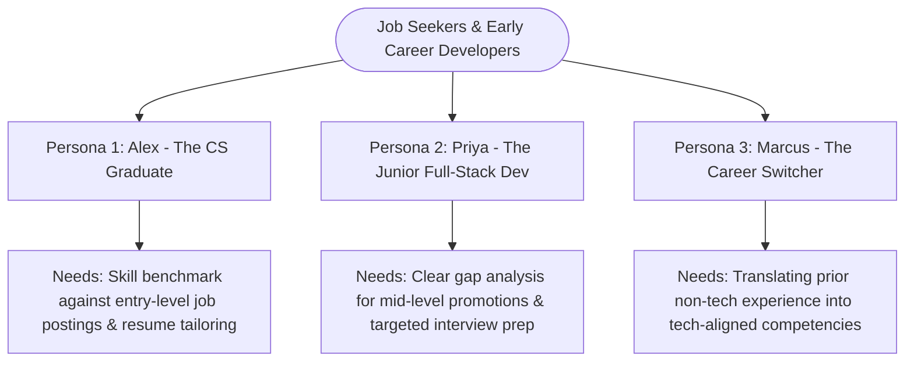
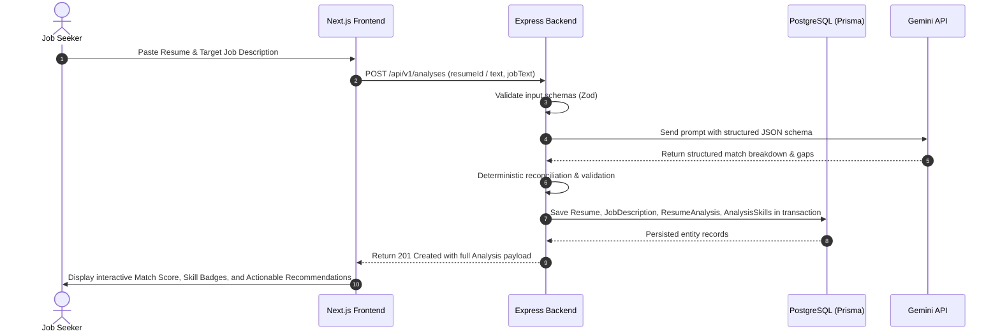
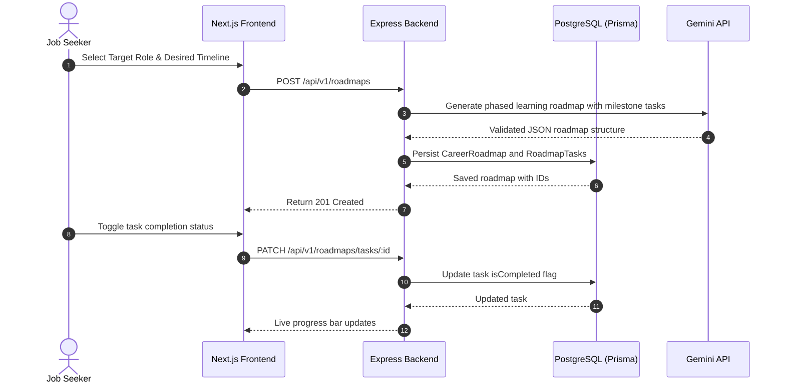

# Project Plan: CareerPilot AI

> **Product Name:** CareerPilot AI  
> **Product Type:** AI-Powered Full-Stack Career Development & Job Alignment Platform  
> **Target Audience:** Students, Fresh Graduates, Junior Developers, Career Switchers, Job Seekers  
> **Document Owner:** Senior Software Architect & Product Analyst  
> **Version:** 1.0.0 (Planning Stage)  
> **Date:** October 2026  

---

## 1. Executive Summary & Project Overview

**CareerPilot AI** is an intelligent, full-stack career readiness platform designed to solve the critical friction job seekers face: understanding whether their skills match current market demands, tailoring their resumes for specific job descriptions, identifying actionable skill gaps, and preparing for technical interviews.

Unlike generic resume builders or unfocused multi-tool websites, CareerPilot AI provides a cohesive, end-to-end journey centered on **data-backed explainability**. The platform takes a candidate's resume and a target job description, performs a multi-dimensional gap analysis (hard skills, experience depth, domain keywords), delivers an explainable qualification match score, and generates a personalized improvement plan.

Built with a modern full-stack architecture (**Next.js**, **Express.js**, **TypeScript**, **PostgreSQL**, and **Prisma ORM**), CareerPilot AI demonstrates robust software engineering standards: strict relational modeling, secure cookie-based session management, server-side AI integration via Google Gemini API with schema enforcement, and comprehensive automated testing.

---

## 2. Problem Statement & User Pain Points

### 2.1 The Core Problem
Early-career technologists and active job seekers face high rejection rates and silent rejections from Applicant Tracking Systems (ATS) and hiring managers. They struggle with three core challenges:
1. **The "Black Box" Job Application Problem:** Candidates do not know why their resume fails to pass initial screenings or how well their background aligns with specific job requirements.
2. **Generic, Unactionable Feedback:** Existing tools provide generic "resume score out of 100" metrics without contextualizing the score against specific job descriptions or distinguishing missing technical skills from missing soft skills.
3. **Disconnected Preparation Workflows:** Job seekers use disparate tools to edit resumes, research technical questions, and track career learning milestones, resulting in scattered context and lack of measurable progress.

### 2.2 Target Users & Personas

#### Persona 1: Alex — The Computer Science New Graduate
- **Background:** Recent graduate with academic projects in Java and Python, seeking their first Junior Software Engineer role.
- **Pain Point:** Applies to 50+ roles with the same generic CV and receives automated rejections. Cannot tell which required frameworks (e.g., Docker, PostgreSQL, TypeScript) are missing from their profile.
- **Goal:** Upload resume, paste a target job description, immediately see missing high-priority skills, and obtain tailored bullet-point recommendations.

#### Persona 2: Priya — The Junior Full-Stack Developer
- **Background:** 1.5 years experience maintaining Express/React apps, aiming for a competitive Frontend/Full-Stack role.
- **Pain Point:** Uncertain how to highlight architectural impact and metrics rather than simple task descriptions.
- **Goal:** Understand technical interview expectations for specific target roles and track learning tasks in a personalized career roadmap.

---

## 3. Product Goals & Core Value Proposition

### 3.1 Product Goals
1. **Explainable Job Matching:** Provide transparent, category-by-category alignment scoring (Matched Skills, Missing Mandatory Skills, Optional/Nice-to-Have Skills) rather than a single unexplained number.
2. **Actionable Remediation:** Convert identified skill gaps into concrete resume rewrite suggestions and structured learning milestones.
3. **End-to-End Workflow Persistence:** Ensure every resume, job description, analysis, roadmap, and interview session is securely persisted and accessible across user sessions.
4. **Engineering Rigor & Trust:** Maintain strict relational data integrity in PostgreSQL, secure authentication via httpOnly cookies, and predictable server-side AI responses validated against strict schemas.

### 3.2 Non-Goals (Explicit Exclusions)
- **Non-Goal 1: E-commerce or Course Marketplace.** No course purchasing, shopping carts, or generic resource selling (eliminating the legacy "Items" feature entirely).
- **Non-Goal 2: Social Networking or Public Profiles.** No user friending, public feeds, or community messaging.
- **Non-Goal 3: Real-Time Audio/Video Proctoring.** Technical interview prep is text-based and rubric-scored; no live video or voice streaming.
- **Non-Goal 4: Automated Job Scraping or Auto-Apply Bots.** Users provide job descriptions directly via text or URL input; the platform does not scrape external job boards or automatically submit applications.

---

## 4. Minimum Viable Product (MVP) Scope Definition

To ensure an assessment-ready, high-quality application with complete workflows rather than shallow half-features, the MVP scope is strictly partitioned:

| Feature Domain | In MVP Scope | Deferred to Future Phase | Rationale |
| :--- | :---: | :---: | :--- |
| **Authentication & User Profiles** | **Yes** | — | Secure email/password registration, login, profile management, and session invalidation via httpOnly cookies. |
| **Resume Management** | **Yes** | — | Create, store, edit, and version text-based resumes (with planned support for clean plain-text/markdown input). |
| **Job Description Capture** | **Yes** | — | Input, parse, and store target job descriptions (Title, Company, Raw Text, Level). |
| **Resume–Job Matching & Skill Gap Analysis** | **Yes** | — | **Flagship AI Feature:** Hybrid deterministic and LLM-driven comparison with structured persistence. |
| **Explainable Action Plan** | **Yes** | — | Prioritized skill gaps, bullet point rewrites, and impact suggestions. |
| **Career Roadmap Generation & Task Tracking** | **Yes** | — | Personalized phase-based roadmap with toggleable milestone tasks stored in PostgreSQL. |
| **Direct PDF/DOCX Parsing Engine** | Deferred | Future | MVP focuses on clean text-extracted resume content to eliminate flaky third-party OCR/parser issues during evaluation. |
| **Interactive Multi-Turn Voice Interview** | Deferred | Future | MVP focuses on structured Q&A generation with self-assessment rubrics. |
| **AI Cover Letter Generator** | Deferred | Future | High-value, but secondary to the core matching and roadmap loop. |

---

## 5. Primary User Journeys

### Journey 1: Resume–Job Description Alignment & Gap Analysis

### Journey 2: Career Roadmap Creation & Milestone Execution

---

## 6. Success Metrics & Quality Criteria

| Metric Category | Assessment Benchmark | Production Target |
| :--- | :--- | :--- |
| **Data Integrity** | 100% of user data linked via foreign keys; zero orphan records. | Zero cascading deletion failures; fully indexed foreign keys. |
| **Security Standard** | 0 tokens stored in `localStorage`; all sessions authenticated via httpOnly cookies. | OWASP Top 10 compliance; strict CORS and CSRF protections. |
| **AI Reliability** | 100% of AI responses conform to defined Zod validation schemas. | Fallback graceful error state with exponential backoff; no app crashes. |
| **API Performance** | P95 latency for non-AI endpoints < 80ms. | P95 latency for AI-assisted matching < 4.5s. |
| **Test Coverage** | Automated test suite verifying auth, validation, matching logic, and API endpoints. | Minimum 85% branch coverage on business logic & validation. |

---

## 7. Risks, Assumptions & Mitigation Strategies

| Identified Risk | Severity | Likelihood | Mitigation Strategy |
| :--- | :---: | :---: | :--- |
| **Gemini API Rate Limiting / 429 Quota Exceeded** | High | Medium | Implement server-side in-memory caching for identical job descriptions, user-level rate limiting, and exponential retry. |
| **Hallucinated or Invalid AI JSON Response** | High | Low | Enforce Gemini `responseSchema` / `application/json` mode paired with strict Zod parsing on the Express backend before persistence. |
| **Scope Creep during Assessment Development** | High | High | Enforce strict phase gates; deliver and test core matching and persistence before touching secondary features. |
| **Assessment Deadline Discrepancy** | High | Confirmed | Recruitment email and assignment document dates may differ. **Deadline must be formally confirmed** prior to scheduling final delivery milestones. |
