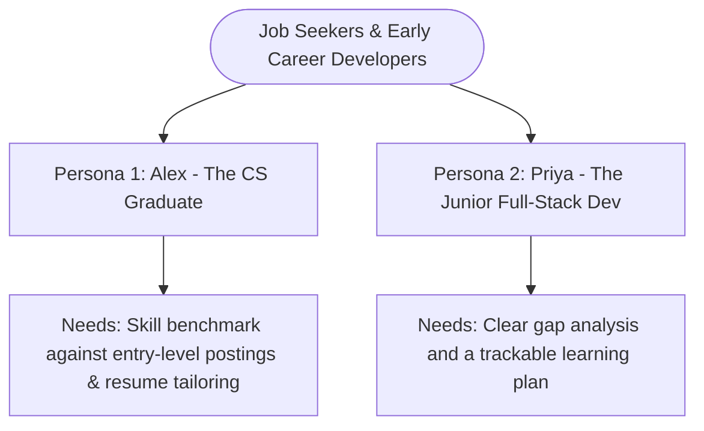
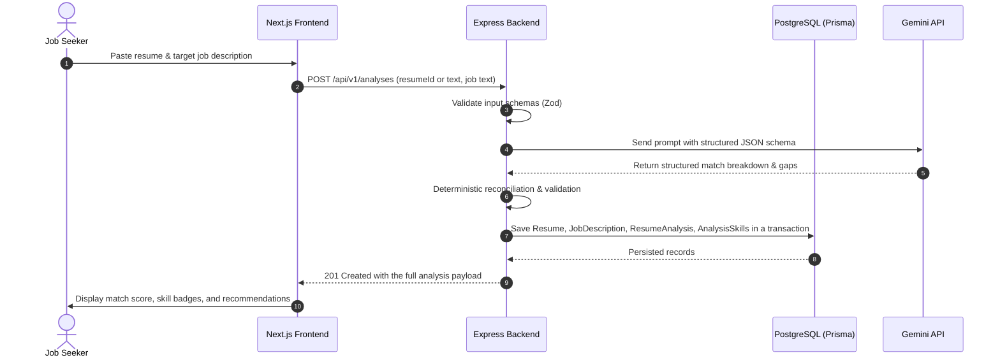
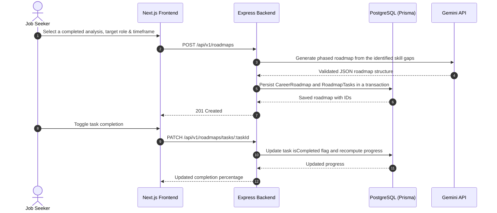

# Project Plan: CareerPilot AI

**Product:** AI-powered career development and job-alignment platform
**Audience:** Students, fresh graduates, junior developers, career switchers, active job seekers

---

## 1. Overview

CareerPilot AI is a full-stack career readiness platform. It tackles a common problem for job seekers: not knowing whether their skills match current market demand, and not knowing how to tailor a resume for a specific job.

Instead of another generic "resume score" tool, the platform takes a candidate's resume and a target job description, runs a multi-dimensional gap analysis (hard skills, experience depth, resume completeness), returns an explainable match score, and generates a personalized improvement plan.

The stack is a standard modern full-stack setup: **Next.js**, **Express.js**, **TypeScript**, **PostgreSQL**, and **Prisma ORM**. The backend uses strict relational modeling, HttpOnly cookie sessions, and server-side AI calls to Google Gemini with schema enforcement. The core logic is covered by an automated test suite.

---

## 2. Problem Statement

Early-career technologists and active job seekers face high rejection rates, often without feedback. Three challenges stand out:

1. **The application black box.** Candidates do not know why their resume fails initial screening or how well it aligns with a specific role.
2. **Generic, unactionable feedback.** Most tools produce a single score without contextualizing it against the job description, and without separating missing hard skills from soft skills.
3. **Disconnected preparation.** Resume editing, skills research, and learning planning happen in separate tools with no shared context or measurable progress.

### Target users

**Persona 1: Alex - the computer science graduate**
- Recent graduate with academic projects in Java and Python, looking for a first junior software engineer role.
- Applies to dozens of roles with the same generic CV and receives automated rejections, with no idea which required tools (Docker, PostgreSQL, TypeScript) are missing.
- Wants to paste a target job description and immediately see missing high-priority skills plus tailored bullet-point suggestions.

**Persona 2: Priya - the junior full-stack developer**
- About 1.5 years maintaining Express/React apps, aiming for a competitive full-stack role.
- Unsure how to highlight architectural impact and metrics rather than list tasks.
- Wants a clear gap analysis and a personalized roadmap with trackable milestones.

---

## 3. Product Goals & Value Proposition

1. **Explainable matching.** Show alignment category by category (matched skills, missing mandatory skills, optional skills) rather than a single unexplained number.
2. **Actionable remediation.** Turn each identified gap into concrete resume rewrites and learning milestones.
3. **Persistent workflow.** Keep every resume, job description, analysis, and roadmap tied to the user's account and available across sessions.
4. **Engineering rigor.** Strict relational integrity in PostgreSQL, cookie-based auth, and predictable AI responses validated against strict schemas.

### Non-goals

- **No marketplace or store.** No course purchasing, carts, or generic resource sales.
- **No social features.** No friending, public feeds, or messaging.
- **No job scraping or auto-apply.** Users paste job descriptions themselves; the platform does not scrape job boards or submit applications.
- **No PDF/DOCX parsing in the MVP.** Resumes are entered as text.

---

## 4. MVP Scope

To keep the assessment build complete rather than broad, the scope is split as follows:

| Feature domain | In MVP | Deferred | Notes |
| :--- | :---: | :---: | :--- |
| **Authentication & user profiles** | Yes | - | Email/password registration, login, profile management, session invalidation via HttpOnly cookies. |
| **Resume management** | Yes | - | Create, store, edit, and delete text-based resumes. |
| **Job description capture** | Yes | - | Store target postings with title, company, raw text, and level. |
| **Resume-Job matching & skill gap analysis** | Yes | - | Flagship feature: hybrid deterministic + LLM comparison with structured persistence. |
| **Action plan** | Yes | - | Prioritized skill gaps, bullet-point rewrites, and impact suggestions. |
| **Career roadmap generation & task tracking** | Yes | - | Phase-based roadmap with toggleable tasks stored in PostgreSQL. |
| **PDF/DOCX parsing** | - | Future | MVP uses clean text input to avoid flaky third-party parsers during review. |
| **Cover letter generation** | - | Future | Secondary to the core matching and roadmap loop. |

---

## 5. Primary User Journeys

### Journey 1: Resume-Job gap analysis

### Journey 2: Career roadmap creation and milestone tracking

---

## 6. Success Criteria

| Area | Target |
| :--- | :--- |
| **Data integrity** | All user data linked by foreign keys; no orphan records; cascading deletes behave correctly. |
| **Security** | No tokens in `localStorage` or `sessionStorage`; all sessions authenticated via HttpOnly cookies. |
| **AI reliability** | All AI responses validated against Zod schemas; clean error state on upstream failure, never fake data. |
| **API performance** | Non-AI endpoints resolve quickly; AI-assisted matching completes within a few seconds. |
| **Test coverage** | Automated tests cover auth, validation, matching logic, and API endpoints. |

---

## 7. Risks & Mitigation

| Risk | Severity | Likelihood | Mitigation |
| :--- | :---: | :---: | :--- |
| **Gemini rate limiting / quota exceeded** | High | Medium | Retry with backoff and rotate to the fallback model. |
| **Invalid or hallucinated AI JSON** | High | Low | Enforce Gemini `responseSchema` plus strict Zod parsing before persistence. |
| **Scope creep** | High | High | Work in priority phases; deliver and test the core matching and persistence loop before secondary features. |
